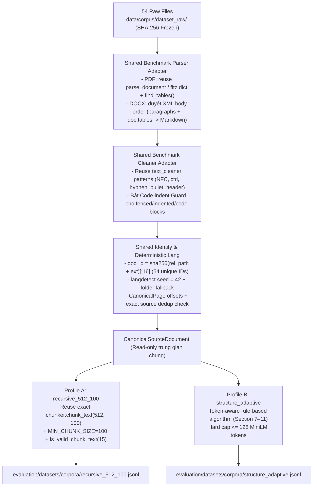

# E1-02 – ĐẶC TẢ KỸ THUẬT STRUCTURE-AWARE ADAPTIVE CHUNKING & OWNERSHIP

> **Dự án:** DSA Document Assistant Using Hybrid RAG
> **Nhiệm vụ:** `E1-02` – Structure-aware Adaptive Chunking Specification & Ownership (**Round 01 – Technical Specification Only**)
> **Workspace:** `D:\DSA-Document-Assistant-Using-Hybrid-RAG`
> **Branch:** `feat/final-readiness`
> **Checkpoint hiện tại (`HEAD`):** `ff2187eb996b380d817d30ded85db42880273d6c` (`E1-01` Checkpoint)
> **Local `main`:** `b84f09450f213b03ad57ef8b388f482ee0f0eaa2`
> **Trạng thái triển khai Profile B:** `DESIGN SPECIFICATION ONLY — IMPLEMENTATION NOT STARTED — RUNTIME NOT VERIFIED`
> **Ngày lập đặc tả:** 2026-11-27

---

## Quy ước trạng thái bằng chứng xuyên suốt tài liệu

| Nhãn | Ý nghĩa bắt buộc |
|---|---|
| `[VERIFIED EXISTING]` | Đọc trực tiếp từ mã nguồn, file cấu hình, HF local cache hoặc quét read-only trên 54 tài liệu gốc trong workspace hiện tại. |
| `[PROPOSED DESIGN]` | Thiết kế, tham số, cấu trúc dữ liệu, pseudocode hoặc hợp đồng tích hợp được đề xuất cho E2–E6; **chưa triển khai**, **chưa đo runtime**. |
| `[APPROVAL PENDING]` | Quyết định kiến trúc / tham số / ownership cần Người quản lý và nhóm phê duyệt trước khi bắt đầu E2-01. |
| `[NOT IMPLEMENTED]` | Chưa có source code hoặc runtime artifact trong repository hiện tại. |

---

## 1. Executive Summary

Tài liệu này đặc tả toàn diện thiết kế kỹ thuật, hợp đồng dữ liệu công bằng và ranh giới sở hữu cho hai chiến lược Chunking phục vụ đánh giá so sánh **`2 Chunking Profiles × 4 Retrieval Methods` (`A1–A4` vs `B1–B4`)** trong lộ trình Evaluation E2–E6:

1. **Profile A (`recursive_512_100`):** Bảo toàn nguyên vẹn thuật toán Recursive Character Text Splitter hiện có trong `backend/app/document_processing/chunker.py` (`chunk_size=512` chars, `chunk_overlap=100` chars, `MIN_CHUNK_SIZE=100` chars, `min_words=15` từ `run_pipeline.py`), nhưng thực thi trên **cùng canonical parsed/cleaned source representation** với Profile B để bảo đảm so sánh công bằng. Phân biệt rõ *production corpus cũ (`5,941` chunks)* với *experimental rebuilt Profile A corpus*.
2. **Profile B (`structure_adaptive`):** Thiết kế mới `[PROPOSED DESIGN / NOT IMPLEMENTED]` theo hướng rule-based, deterministic, nhận diện 10 loại khối nội dung DSA (Heading, Definition, Narrative paragraph, Algorithm explanation, Algorithm steps, Code block, Pseudocode, Formula, Complexity analysis, Table), áp dụng **hard token budget từ tokenizer thực tế của Embedding model**:
   `len(tokenizer(final_text, add_special_tokens=True, truncation=False)["input_ids"]) <= 128` (`paraphrase-multilingual-MiniLM-L12-v2`, rev `e8f8c211226b894fcb81acc59f3b34ba3efd5f42`), cùng adaptive overlap và provenance đầy đủ cấp source span.
3. **Tích hợp ưu tiên Level 1 (Evaluation-only):** Tái sử dụng tối đa parser/cleaner/chunker/indexing/RetrievalEngine sẵn có thông qua các adapter/runner nằm gọn trong `evaluation/`, **không** chỉnh sửa production pipeline, **không** ghi đè `data/corpus/dataset_clean/chunks_all.jsonl` hay `data/runtime/qdrant_local/`, và trình bày minh bạch **Option A vs Option B** về ownership trước khi triển khai E2-01.

---

## 2. Git State

Xác minh trực tiếp bằng Git read-only commands tại đầu phiên E1-02 (`[VERIFIED EXISTING]`):

| Kiểm tra | Kết quả thực tế |
|---|---|
| `git rev-parse --show-toplevel` | `D:/DSA-Document-Assistant-Using-Hybrid-RAG` |
| `git branch --show-current` | `feat/final-readiness` |
| `git rev-parse HEAD` | `ff2187eb996b380d817d30ded85db42880273d6c` |
| `git rev-parse refs/heads/main` | `b84f09450f213b03ad57ef8b388f482ee0f0eaa2` |
| `git status --short --branch` (trước khi tạo đặc tả) | `## feat/final-readiness`, untracked: `EVALUATION_MASTER_AUDIT_REPORT.md`, `PROJECT_AUDIT_FINAL_READINESS.md` |
| `git diff --stat` | Rỗng (`0` tracked files modified) |
| `git diff --cached --stat` | Rỗng (`0` staged files) |
| `git diff --check` | Exit code `0` |

---

## 3. Existing Recursive Baseline

Phân tích chi tiết từ mã nguồn hiện tại (`[VERIFIED EXISTING]`):

### 3.1. Cơ chế & Tham số thực tế của Profile A (`recursive_512_100`)

| Thành phần | Vị trí mã nguồn | Giá trị / Hành vi thực tế |
|---|---|---|
| **Entry point chunker** | `backend/app/document_processing/chunker.py:104-143` | `chunk_text(clean_text, chunk_size=512, chunk_overlap=100)` — docstring dòng 1 ghi `"structure-aware document chunking"` nhưng cài đặt là **Recursive Character Text Splitter**. |
| **Đơn vị đo kích thước** | `chunker.py:13-15,42,72` | **Characters (`len(str)`)**, không dùng token count. |
| **Maximum chunk size** | `chunker.py:13` | `DEFAULT_CHUNK_SIZE = 512` chars. |
| **Overlap** | `chunker.py:14,61-65` | `DEFAULT_CHUNK_OVERLAP = 100` chars. Khi tách theo `sep` ra `>= 2` đoạn, ghép `chunks[i-1][-100:] + " " + chunks[i]`, sau đó nếu vượt `512` chars lại gọi `_recursive_split()` đệ quy ở `chunker.py:82-83`. |
| **Thứ tự ưu tiên Separator** | `chunker.py:18` | `["\n\n", "\n", ". ", " ", ""]`. Nếu đến `""` vẫn vượt `chunk_size`, fallback cắt cứng tại `range(0, len(text), chunk_size - overlap)` = bước `412` chars (`chunker.py:89`). |
| **Minimum chunk & word filter** | `chunker.py:15,133-134`; `text_cleaner.py:98-115`; `run_pipeline.py:104` | `MIN_CHUNK_SIZE = 100` chars (trong `chunk_text()`, bỏ âm thầm không log). Sau đó caller `run_pipeline.py:104` (và `ingestion_flow.py:74`) gọi `is_valid_chunk_text(text, min_words=15)` ghi đè mặc định `min_words=20`; đồng thời loại bỏ chunk nếu `> 80%` tokens không chứa `[a-zA-ZÀ-ỹ]`. |
| **Ranh giới Page / Section** | `document_parser.py:44,74-81`; `run_pipeline.py:87-97`; `chunker.py:21-24,92-97` | PDF: chạy `chunk_text()` độc lập trên từng trang vật lý (không gộp xuyên trang). DOCX: tách "trang ảo" khi gặp style `Heading 1`. `section`: `_HEADING_RE` chỉ bắt Markdown `#` và mục số `x.y` (khiến `5,208 / 5,941` = `87.7%` chunks trong `chunks_all.jsonl` có `section = null`). |
| **Empty text filtering** | `text_cleaner.py:69-70`; `run_pipeline.py:93-94`; `chunker.py:124-125` | `clean_text()` trả `""` nếu rỗng/toàn whitespace; bị bỏ ở bước 2 của pipeline. |
| **Chunk & Document identity** | `metadata.py:17-27` vs `ingestion_flow.py:26-27,86-89` | Offline `metadata.py`: `document_id = slug(Path(filename).stem)` (gây 13 va chạm giữa `.pdf` & `.docx`); `chunk_id = sha1(f"{doc_id}:p{page}:i{idx}:{text[:64]}")[:16]`. Online `ingestion_flow.py` ghi đè thành `sha256`. |
| **Metadata output** | `contracts.py:9-16`; `metadata.py:60-76`; `run_pipeline.py:115-118` | Top-level `DocumentChunk`: `chunk_id, document_id, filename, page, section, text, metadata` với `metadata = {language, chunk_index, char_count, file_type}`. |
| **Existing unit tests** | `tests/` | **0 file unit test riêng** cho `document_parser.py`, `text_cleaner.py`, `chunker.py`, `metadata.py` (chỉ được test gián tiếp trong `tests/integration/test_document_lifecycle.py` bằng 2 file tổng hợp ngắn). |

### 3.2. Cách Profile A xử lý các trường hợp biên hiện tại & Chính sách đối chứng

1. **Empty text:** Bị loại trước khi vào chunker (`clean_text() == ""`).
2. **Short definitions / Short algorithm steps / Tail chunks (`< 100` chars hoặc `< 15` words):** Bị `MIN_CHUNK_SIZE = 100` (`chunker.py:133`) hoặc `is_valid_chunk_text(..., min_words=15)` (`run_pipeline.py:104`) **loại bỏ âm thầm** nếu nằm ở trang/đoạn đứng riêng hoặc là phần đuôi còn sót lại sau khi tách.
3. **Code fragments / Dense symbol lines:** Nếu một đoạn code ngắn toàn ký hiệu (`{`, `}`, `<=`, `->`, `i++`) khiến tỷ lệ từ không chứa chữ cái `[a-zA-ZÀ-ỹ]` vượt `80%`, `is_valid_chunk_text()` (`text_cleaner.py:112-114`) sẽ **loại bỏ** đoạn code đó. Với code dài `> 512` chars (hoặc sau khi xóa indent bởi `_HSPACE_RE`), `_recursive_split` cắt theo `\n` / `. ` / ` ` mà không bảo toàn khối hàm/vòng lặp.
4. **Table rows:** Trong parser production hiện tại, 17 bảng DOCX bị bỏ qua hoàn toàn; còn bảng trong PDF xuất hiện dạng text phẳng bị `_HSPACE_RE` nén khoảng trắng cột thành 1 space rồi cắt vô ý thức hàng/tiêu đề cột khi vượt `512` chars.
5. **Phân biệt hai thực thể dữ liệu Profile A:**
   - **Existing production corpus (`data/corpus/dataset_clean/chunks_all.jsonl`):** `5,941` chunks (`5,735` PDF, `206` DOCX), mang 13 `document_id` collisions, thiếu 17 bảng DOCX, mất code indentation, không sửa đổi và **KHÔNG** dùng để so trực tiếp với Profile B.
   - **Rebuilt experimental Profile A (`recursive_512_100` benchmark corpus):** Giữ nguyên **100% logic `chunk_text(chunk_size=512, chunk_overlap=100)` + `MIN_CHUNK_SIZE=100` + `is_valid_chunk_text(..., min_words=15)`**, nhưng chạy trên **shared benchmark canonical source** (đã trích 17 bảng DOCX, giữ indent, bỏ collision `document_id`). Do đầu vào sạch có thêm bảng DOCX và bảo toàn cấu trúc dòng code, số lượng chunks của experimental Profile A **có thể khác `5,941`**. Khác biệt content retention (ví dụ Profile A drop đuôi `<100` chars trong khi Profile B giữ short complete definitions) được ghi nhận minh bạch là **một phần thuộc tính của từng chunking policy**.

---

## 4. Adaptive Research Objectives

Nghiên cứu thực nghiệm E2–E6 hướng tới **5 mục tiêu định lượng khách quan** (`[PROPOSED DESIGN]`):

1. **Retrieval Quality Comparison:** So sánh Precision@K, Recall@K, MRR@K, nDCG@K (`K = 1, 3, 5, 10, 15`) và Evidence-level Recall/Precision@K giữa Profile A (`A1–A4`) và Profile B (`B1–B4`) trên cùng query set.
2. **Retrieval Latency Comparison:** Đo warmed per-query latency (`Mean`, `P50`, `P95`, có CUDA sync trên GPU) và tách cold-start vs warm retrieval latency ở tất cả 8 tổ hợp.
3. **Embedding Truncation Reduction:** Định lượng tỷ lệ chunks vượt `128` tokens trên `paraphrase-multilingual-MiniLM-L12-v2` giữa experimental Profile A (với baseline production cũ ghi nhận `45.95%` bị cắt cụt) và Profile B (`target: 0%` vượt hard budget, hoặc thống kê mọi forced split/exception nếu xảy ra).
4. **DSA Knowledge Unit Preservation:** Đánh giá khả năng giữ nguyên vẹn định nghĩa, thuật toán nhiều bước, code block có indentation và bảng tiêu đề (số trường hợp giữ nguyên đơn vị kiến thức trong human judging & diagnostics).
5. **Hybrid Rerank Quality–Latency Trade-off (`A4` vs `B4`):** Phân tích sự đánh đổi giữa chất lượng xếp hạng lại của `BAAI/bge-reranker-v2-m3` và tổng latency khi số lượng chunk, phân bố độ dài token và stage latencies (`bm25_ms`, `dense_embed_ms`, `qdrant_ms`, `rrf_ms`, `rerank_ms`) thay đổi theo chiến lược chunking.

> **Nguyên tắc khoa học:** Không giả định trước Profile B chắc chắn thắng về chất lượng hay nhanh hơn về latency. Đặc biệt, chunk ngắn hơn có thể làm tăng tổng số chunks trong corpus (kéo theo tăng độ dài payload BM25/Qdrant hoặc số chunk bị phân mảnh) hoặc thay đổi phân bố điểm RRF — mọi kết luận chỉ được rút ra sau E4–E6.

---

## 5. Dataset Structure Analysis

Tổng hợp kết quả đo đạc read-only trên `data/corpus/dataset_raw/` (`[VERIFIED EXISTING]` — phân tách rõ **toàn tập** vs **tập mẫu** theo Mandatory Correction 07):

| Phạm vi kiểm tra | Dữ liệu kiểm chứng | Tín hiệu & Đặc điểm phát hiện | Hạn chế của phép kiểm tra |
|---|---|---|---|
| **Toàn bộ 54 files gốc** (`41` PDF, `13` DOCX) | `80,294,690` bytes (`76.57 MiB`), `54/54` SHA-256 duy nhất, `0` corrupted | `13` cặp cùng stem (`.pdf` + `.docx`: `001–006 Eng`, `001–007 Vie`) | Thư mục tiếng Anh DOCX đặt tên nhầm `end_docx` |
| **Toàn bộ 13 DOCX** (`505` non-empty paragraphs) | `doc.paragraphs` + `doc.tables` | Styles thực tế: `Normal` (202), `Normal (Web)` (117), `List Bullet` (58), `List Paragraph` (46), `Heading 1` (43), `Heading 2` (20), `Title` (12), `Heading 3` (4), `Heading 4` (2), `HTML Preformatted` (1). Tổng `17` tables (đều ở `002_train_file_Vie.docx`), `0` horizontal merged cells, `0` nested tables. | Có `117` đoạn `Normal (Web)` và `1` `HTML Preformatted`, tức một phần giáo trình DOCX copy từ web không dùng chuẩn `Heading`/`Code` style đồng nhất. |
| **Toàn bộ 41 PDF** (`1,683` pages) | `pymupdf` `page.get_text("text")` | `8 / 1,683` trang `< 30` ký tự (`0.48%`). Regex quét toàn văn: `763 / 1,683` trang (`45.3%`) chứa từ khóa code/pseudocode; `445 / 1,683` trang (`26.4%`) chứa ký hiệu Big-O/`Θ`/`Ω`. Scanned check: **`0` file** thỏa `avg_chars_per_page < 100 or (pages >= 5 and empty_ratio > 0.5)`. | Phép check scanned PDF chỉ khẳng định ở mức tài liệu có text layer; **không** phát hiện được hình ảnh/sơ đồ/công thức scan cục bộ nhúng bên trong các trang nhiều chữ; `763`/`445` trang là mật độ từ khóa thô, chưa phải nhãn accuracy. |
| **Mẫu 10 PDF đầu × 3 trang đầu** (`5,363` spans) | `pymupdf` `page.get_text("dict")` | `461` spans có cờ bold (`flags & 16`). Font sizes phổ biến: `12.0` (3,847), `10.0` (653), `10.9` (327), `8.0` (306), `14.3` (104), `6.0` (90), `17.2` (20), `9.6` (11). Vị trí trái `bbox[0]` phân cụm theo mức thụt lề (`72, 89, 101, 115, 127, 137`). | Đây là thống kê trên **30 trang mẫu đầu**, không suy diễn đồng nhất sang cả 41 PDF (gồm giáo trình, slide, handout đa nguồn). Không có ground truth cấu trúc để công bố % detection accuracy. |

---

## 6. Content Detection Rules

Đánh giá tính khả thi nhận diện **10 loại nội dung DSA** hoàn toàn bằng luật (không OCR, không LLM segmentation, `[PROPOSED DESIGN]`):

| Content type | Available parser signal | Detection rule (deterministic, rule-based) | Reliability (đánh giá thiết kế) | Failure cases | Fallback |
|---|---|---|---|---|---|
| **1. Heading** | DOCX: `Title`, `Heading 1..4`; PDF: `span.size > body_median * 1.15`, `bold` flag, dòng ngắn `<= 12` từ, không kết thúc bằng `.` hoặc `,`, regex mục `^(\d+\.)+\d*\s+.+` / `^(Chương\|Chapter\|Phần\|Bài)\s+` | Khớp DOCX Heading/Title style **hoặc** dòng ngắn khớp regex mục số/chương **hoặc** dòng ngắn đứng độc lập có font size lớn hơn body/bold | Cao ở DOCX dùng chuẩn Heading; Trung bình–Khá ở PDF (dễ nhầm caption/tên bảng) | DOCX dùng style `Normal (Web)` in đậm thay vì `Heading`; tiêu đề slide dài 2 dòng bị gãy | Gán `narrative` nếu quá dài (>15 tokens hoặc kết thúc dấu chấm) nhưng vẫn giữ ngữ cảnh section trước đó |
| **2. Definition** | Từ khóa dẫn ngữ nghĩa đầu đoạn (`Định nghĩa:`, `Khái niệm:`, `Definition:`, `... là một ...`, `... được định nghĩa là ...`, `A ... is a data structure that ...`), thường có nhãn in đậm ở đầu | Dòng/đoạn bắt đầu bằng marker định nghĩa **hoặc** khớp mẫu `"<Thuật ngữ> là <mô tả>"` với độ dài `<= 80` tokens và không phải danh sách code | Trung bình–Khá (phụ thuộc từ khóa tường minh) | Định nghĩa viết ẩn trong văn xuôi tự sự không có từ khóa dẫn | Phân loại thành `narrative` và chia theo ranh giới câu |
| **3. Narrative paragraph** | Văn bản thông thường (`Normal`, `Normal (Web)`), mật độ chữ cái cao, kết thúc bằng dấu chấm câu, không khớp code/table/heading/list | Mọi khối văn xuôi không kích hoạt các luật cấu trúc ưu tiên cao hơn | Cao (nhóm mặc định an toàn) | Lẫn câu công thức nội tuyến hoặc pseudocode viết liền không xuống dòng | Giữ nguyên theo đoạn, vượt budget thì chia theo ranh giới câu |
| **4. Algorithm explanation** | Cụm heading/từ khóa (`Ý tưởng`, `Nguyên lý hoạt động`, `Hoạt động`, `Approach`, `Algorithm idea`, `Intuition`), nằm ngay trước `algorithm_steps` hoặc `code_block` | Đoạn văn giải thích thuật toán khớp từ khóa ý tưởng/nguyên lý **hoặc** đoạn narrative liên kết danh sách bước thuật toán liền kề | Trung bình (dễ giao thoa với `narrative`) | Đoạn giải thích thuần ngữ nghĩa không có từ khóa báo hiệu | Xử lý như `narrative` có overlap bối cảnh nhỏ (`10–15` tokens) |
| **5. Algorithm steps** | DOCX: `List Paragraph`, `List Bullet`, đánh số `1. `, `2. `, `Bước 1:`, `Step 1:`; PDF: cụm >= 2 dòng liên tiếp cùng tiền tố đánh số/bullet và cùng mức thụt `x0` | Chuỗi `>= 2` items liên tiếp bắt đầu bằng `\d+[\.\)]`, `Bước \d+`, `Step \d+`, hoặc bullet `-`/`*` nằm dưới ngữ cảnh thuật toán | Khá–Cao khi có đánh số/bullet rõ ràng | PDF mất thụt lề hoặc PDF 2 cột làm đảo thứ tự dòng bước | Giữ từng bước như list item; vượt budget thì cắt giữa hai bước, lặp 1 bước hoặc mô tả ngắn nếu cần |
| **6. Code block** | DOCX: `HTML Preformatted` / monospace font (`Consolas`, `Courier`); PDF: monospace font hoặc `bbox[0]` thụt lề tăng so với lề body, mật độ ký hiệu lập trình cao (`;`, `{`, `}`, `()`, `->`, `def `, `void `, `int `, `for(`, `while(`, `return `) | Khớp >= 2 dấu hiệu trên chuỗi dòng liên tiếp (fence / monospace font / từ khóa cú pháp + ký hiệu lập trình >= 2 dòng) | Khá–Cao với C/C++/Python/Java chuẩn | Đoạn 1 dòng inline code lẫn trong văn bản; slide chụp code dạng ảnh | Nếu là dòng đơn inline → giữ cùng `narrative`; nếu code dài > 126 tokens → tách theo hàm/khối thụt lề rồi mới tách theo dòng |
| **7. Pseudocode** | Từ khóa giả mã (`Thuật toán`, `Algorithm`, `Procedure`, `Function`, `Input:`, `Output:`, `Repeat`, `Until`, `If ... then`, `Else`, `For ... to`, `While ... do`, `←`, `:=`), thường đánh số dòng | Khối `>= 2` dòng có >= 2 cấu trúc giả mã (`Input/Output`, `Procedure/Algorithm`, `←`, `:=`, `If..then`, `For..to`) mà không có dấu chấm phẩy/cú pháp ngôn ngữ cài đặt | Khá | Pseudocode tiếng Việt tự nhiên pha giả mã dễ lẫn với `algorithm_steps` | Nếu mơ hồ giữa `pseudocode` và `algorithm_steps`, ưu tiên `pseudocode` khi có `← / := / Input / Output`; split theo dòng giữ thụt lề |
| **8. Formula** | Ký tự toán học Unicode (`∑`, `∏`, `∀`, `∃`, `≤`, `≥`, `≠`, `≈`, `∈`, `∪`, `⌊`, `⌋`, `⌈`, `⌉`), biểu thức quan hệ truy hồi `T(n) = ...`, chỉ số mũ/dưới | Dòng ngắn hoặc biểu thức cô lập có mật độ ký hiệu toán/truy hồi cao (`T(n)=`, `∑`, `log`, `=`) | Trung bình (PDF toán thường tách mỗi ký hiệu thành 1 `span` lệch dòng `y0`) | Công thức dạng ảnh trong PDF hoặc PDF tách chỉ số trên/dưới thành nhiều dòng rời rạc | Hợp nhất các spans cùng dải `y0 (±3pt)`; nếu công thức gắn liền câu giải thích → giữ chung với `narrative` / `complexity_analysis` cha |
| **9. Complexity analysis** | Ký hiệu tiệm cận (`O(...)`, `Θ(...)`, `Ω(...)`), từ khóa (`Độ phức tạp`, `Time complexity`, `Space complexity`, `Best case`, `Worst case`, `Average case`, `Không gian`) | Đoạn hoặc câu chứa ký hiệu `O/Θ/Ω(...)` **hoặc** từ khóa độ phức tạp thời gian/không gian | Cao ở phát hiện từ khóa; Trung bình ở ranh giới đoạn | Xuất hiện dưới dạng 1 dòng cuối ngay trong `code_block` hoặc là 1 câu ngắn cuối đoạn văn | Nếu là dòng comment cuối trong `code_block` → tách thành block `complexity_analysis` riêng sau khi kết thúc code (trừ comment nội tuyến `<= 1` dòng); nếu lẫn trong prose mà tổng <= 110 tokens → giữ nguyên |
| **10. Table** | DOCX: đối tượng `doc.tables` trích theo thứ tự XML body; PDF: `page.find_tables()` của PyMuPDF **hoặc** lưới tọa độ cột (`>= 3` dòng có `>= 2` cụm `x0` thẳng cột) | DOCX: bất kỳ phần tử `w:tbl` trong body; PDF: xác nhận qua `find_tables()` có `>= 2` hàng & `>= 2` cột hợp lệ | Rất cao ở DOCX (`17/17` bảng đều sạch); Trung bình ở PDF (dễ nhầm bảng không kẻ viền) | Bảng PDF không có đường kẻ ngang/dọc làm `find_tables()` bỏ sót | Chuẩn hóa thành Markdown pipe table; nếu `find_tables()` PDF miss → rơi về `narrative` / line block (không giả lập cột bừa bãi) |

---

## 7. Adaptive Chunking Algorithm

Kiến trúc xử lý theo pipeline **8 bước deterministic** (`[PROPOSED DESIGN / NOT IMPLEMENTED]`):

```text
Structured content blocks (từ Shared Canonical Source)
  → 1. Content type detection (theo bảng ưu tiên phân loại)
  → 2. Topic boundary & compatible block grouping (heading propagation, gắn định nghĩa/steps ngắn)
  → 3. Content-specific soft target assignment
  → 4. Boundary-aware splitting (ưu tiên hàm/bước/hàng/câu)
  → 5. Adaptive overlap assembly (chỉ chèn khi thỏa điều kiện nội dung & ngân sách)
  → 6. Final-text token budget validation (`len(emb_tok(final_text, add_special_tokens=True)) <= 128`)
  → 7. Oversized deterministic fallback (nếu vượt trần sau bước 5–6)
  → 8. Chunk metadata & source span provenance emission
```

### 7.1. Thứ tự ưu tiên phân loại & Xử lý nội dung pha trộn (Mandatory Correction 04)

Khi một block khớp nhiều dấu hiệu cùng lúc, áp dụng **strict precedence order (từ cao xuống thấp)**:

1. `table` (DOCX XML table hoặc PDF `find_tables()` đã xác nhận — tách riêng, không trộn văn xuôi).
2. `heading` (nếu là tiêu đề mục/chương/slide độc lập, không phải dòng code).
3. `code_block` (từ khóa/cú pháp ngôn ngữ lập trình thực thi >= 2 dòng hoặc fenced/HTML preformatted).
4. `pseudocode` (giả mã `Algorithm`/`Procedure`/`←`/`:=` không thuộc nhóm `code_block`).
5. `complexity_analysis` (phân tích `O/Θ/Ω` hoặc `Time/Space complexity` đứng thành câu/đoạn riêng).
6. `algorithm_steps` (chuỗi `>= 2` bước đánh số/bullet thuật toán).
7. `definition` (câu/đoạn định nghĩa khái niệm DSA).
8. `formula` (phương trình truy hồi / biểu thức toán học độc lập).
9. `algorithm_explanation` (đoạn giải thích ý tưởng gắn với `algorithm_steps`/`code_block` liền kề).
10. `narrative` (mặc định cuối cùng cho mọi khối chữ đọc được còn lại).

**Quy tắc tách Mixed-content Block (ví dụ: đoạn vừa chứa `code` vừa chứa `complexity_analysis`, hoặc `definition` dính liền bảng/steps):**
- Quét từng dòng trong block trước khi đóng gói: nếu phát hiện **chuyển pha cấu trúc rõ ràng** (ví dụ từ dòng code thụt lề sang dòng văn bản lề trái chứa `"Độ phức tạp thời gian: O(n log n)"`, hoặc trước/sau block bảng), bộ tách tiền-gom **cắt block tại ranh giới chuyển dòng** thành 2 `CanonicalBlock` liên tiếp (`[code_block, complexity_analysis]`), mỗi sub-block mang đúng offset gốc của mình.
- Ngoại lệ: 1 câu/comment độ phức tạp ngắn (`<= 12` tokens) nằm bên trong comment `// ...` hoặc `# ...` của code vẫn thuộc `code_block`. Nếu phần văn xuôi kèm `formula` ngắn không tách riêng nghĩa → giữ chung loại cha.

### 7.2. Bảng cấu hình Adaptive đề xuất hoàn chỉnh (Implementable Config Table)

Mọi thông số dưới đây là **proposed experimental configuration `[PROPOSED DESIGN]`**, được chốt thành bất biến cấu hình ở E2 (`ADAPTIVE_CONFIG_V1`), **không** dùng kết quả held-out test để tinh chỉnh:

| Content type | Soft Min (`tok`) | Soft Target (`tok`) | Soft Max (`tok`) | Hard Max (`final_text`, with special) | Allow short standalone? | Grouping / Merge Rule | Overlap Activation & Cap |
|---|---:|---:|---:|---:|---|---|---|
| `heading` | 2 | — | 24 | **128** *(gộp vào chunk con)* | Không đứng 1 mình nếu có body con theo sau trong cùng section | Gắn làm prefix `"{section_path}\n"` cho chunk nội dung kế tiếp cùng section (tối đa 1 lần lặp/chunk) | Không áp dụng riêng |
| `definition` | 12 | 30–60 | 60 | **128** (<=126 content) | **CÓ** (nếu định nghĩa hoàn chỉnh >= 12 tokens) | Chỉ merge 2 `definition` ngắn liền kề cùng topic nếu tổng `final_text <= 60` tokens (với `add_special_tokens=True <= 62`) | **0 tokens** nếu định nghĩa hoàn chỉnh; nếu forced-split vì >128 → overlap `<= 12` tokens tại câu trước |
| `narrative` | 20 | 50–90 | 90 | **128** | CÓ nếu là khối kết thúc section/trang | Merge các `narrative` liền kề **cùng `(document_id, section_id)`** cho đến khi tiệm cận `90` tokens; KHÔNG merge qua `heading` hoặc topic mới | **12–18 tokens** (câu hoàn chỉnh cuối hoặc đuôi từ nguyên vẹn) khi split cùng block/section; `0` khi đổi heading |
| `algorithm_explanation` | 20 | 70–110 | 110 | **128** | CÓ | Có thể ghép với `algorithm_steps` đầu tiên nếu tổng `<= 110` content tokens và cùng `section_id` | **12–20 tokens** (câu dẫn cuối) giữa các chunks cùng chuỗi giải thích thuật toán |
| `algorithm_steps` | 20 | 70–110 | 110 | **128** | CÓ | Giữ trọn các bước trong 1 chunk nếu tổng `<= 110`; nếu dài nhiều bước → chia giữa hai bước nguyên vẹn | **15–22 tokens**: lặp lại tối đa 1 bước gần nhất hoặc dòng tên thuật toán ở đầu chunk sau nếu tổng vẫn `<= 128` (cả special tokens) |
| `code_block` | 15 | 50–115 | 115 | **128** | **CÓ** | **Không bao giờ** merge hai `code_block` khác hàm/ví dụ chỉ để tăng kích thước; giữ nguyên 1 hàm ngắn trọn khối | Mặc định **0 tokens** nếu tách sạch ở hàm con; nếu buộc cắt trong 1 thân hàm → giữ dòng chữ ký (`def/void/for`) `<= 20` tokens làm header lặp |
| `pseudocode` | 15 | 50–115 | 115 | **128** | **CÓ** | Giữ trọn 1 `Procedure/Algorithm` nếu `<= 115` tokens; chia theo cấp khối thụt lề / nhãn bước nếu dài | Lặp lại dòng tiêu đề `Algorithm/Procedure (...)` (`<= 20` tokens) khi tách đa chunk, miễn tổng `<= 128` |
| `formula` | 8 | 20–80 | 80 | **128** | CÓ (nếu không ghép được) | Ưu tiên gắn vào `narrative`/`definition`/`complexity_analysis` liền trước hoặc liền sau cùng `section_id` nếu tổng `<= 90` | **0 tokens** khi giữ trọn công thức |
| `complexity_analysis` | 12 | 30–80 | 80 | **128** | **CÓ** (đơn vị kiến thức trọn vẹn) | Giữ nguyên khối độc lập; chỉ gắn cuối `algorithm_explanation` nếu tổng `<= 110` và cùng section | **0 tokens** nếu trọn vẹn; `<= 12` tokens tên thuật toán nếu tách khỏi block dài |
| `table` | 15 | 30–100 | 100 | **128** | **CÓ** | **Không bao giờ** merge `table` với văn xuôi hoặc table khác | Bắt buộc **lặp lại table header row(s)** ở mỗi chunk chia theo hàng (chi phí tính trực tiếp vào ngân sách `128` của `final_text`) |

**Tham số toàn cục bổ sung (`ADAPTIVE_CONFIG_V1`):**
- `tokenizer_id`: `"sentence-transformers/paraphrase-multilingual-MiniLM-L12-v2"` (`rev: e8f8c211226b894fcb81acc59f3b34ba3efd5f42`, `local_files_only=True`)
- `HARD_MAX_TOTAL_EMBED_TOKENS = 128` *(tính trên `len(emb_tok.encode(final_text, add_special_tokens=True, truncation=False))`)*
- `PROPOSED_CONTENT_BUDGET = 126` *(trước khi cộng 2 special tokens)*
- `MIN_PROSE_KEEP_WORDS = 3` *(chỉ lọc chuỗi rác thuần ký hiệu vô nghĩa `< 3` tokens chữ/số không thuộc công thức/bảng; KHÔNG dùng ngưỡng cứng 100 chars để xóa định nghĩa/công thức ngắn)*
- `HEADING_PREFIX_MAX_TOKENS = 24` *(nếu heading dài hơn 24 tokens → cắt gọn phần prefix lặp ở 24 tokens nhưng vẫn giữ bản đầy đủ ở chunk đầu tiên chứa heading đó)*
- `MERGE_CROSS_PAGE_DOCX_H1 = False`, `MERGE_CROSS_PDF_PAGE_FOR_SAME_CONTINUATION = False` *(giữ trang rõ ràng tương tự Profile A để tránh làm nhiễu coordinate provenance `(page)` ở E3; ghi chú mở rộng nghiên cứu sau nếu cần)*.

### 7.3. Quy tắc Boundary & Topic Isolation (Mandatory Correction 04)

1. **Khi nào giữ nguyên block:** Block thuộc `definition`, `code_block`, `pseudocode`, `table`, `complexity_analysis`, `formula`, hoặc `algorithm_steps` ngắn có tổng token `<= soft_max` (và `final_text <= 128` tokens). **Không bao giờ xóa** một `definition` / `complexity_analysis` / `code_block` hoàn chỉnh chỉ vì độ dài dưới `soft_min`.
2. **Khi nào merge các blocks:** Chỉ merge 2 block liền kề `b_i` và `b_{i+1}` khi thỏa **đồng thời cả 5 điều kiện**:
   - Cùng `(document_id, page, section_id)`;
   - Không ngăn cách bởi `heading` mới, `table`, hay chuyển đổi chủ đề lớn (số mục đổi từ `3.1` → `3.2`);
   - Cặp loại tương thích: `(narrative, narrative)`, `(definition, definition)` cùng khái niệm, `(narrative/algorithm_explanation, formula)`, `(algorithm_explanation, algorithm_steps)`, hoặc `(heading, child_block)`;
   - Tổng token thật của text đã lắp ráp `<= target_soft_max(merged_type)` (và `<= 128` với special tokens);
   - Nếu `b_i` đã có `definition` dài `>= 30` tokens và `b_{i+1}` là một `definition` cho khái niệm mới → **KHÔNG merge**.
3. **Khi nào split & Thứ tự ưu tiên boundary:** Khi block vượt `soft_max` (hoặc `final_text > 128` tokens):
   - *Text (`narrative`, `definition`, `algorithm_explanation`):* Đoạn `\n\n` → Câu hoàn chỉnh (`. `, `? `, `! `, `.\n`) → Mệnh đề (`; `, `: `, `, `) → Dòng `\n` → Từ (` `) → Deterministic token-span split (Mandatory Correction 03).
   - *`algorithm_steps`:* Giữa 2 bước lớn (`Step/Bước k` hoặc mục cấp 1) → Sub-bullet → Câu bên trong 1 bước → Từ → Token-span.
   - *`code_block` / `pseudocode`:* Ranh giới hàm/thủ tục/lớp (mức thụt lề = `0` của từ khóa `def/void/int/class/Procedure/Algorithm`) → Ranh giới khối lệnh (`if/for/while` cùng mức thụt nhỏ hơn) → Giữa 2 dòng code `\n` → Token-span trên 1 dòng dài.
   - *`table`:* Giữa các hàng dữ liệu `<tr>` / dòng Markdown (bảo toàn trọn 1 hàng khi hàng + header `<= 128` tokens) → Chia theo nhóm cột hoặc mô tả `Header: Cell` trên 1 hàng siêu dài (>128 tokens) → Token-span.

---

## 8. Algorithm Pseudocode & Design Worked Examples

### 8.1. Pseudocode Deterministic hoàn chỉnh (`[PROPOSED DESIGN / NOT IMPLEMENTED]`)

```text
ALGORITHM StructureAdaptiveChunk(canonical_doc, emb_tokenizer, config):
  INPUT:
    canonical_doc : CanonicalDocument(document_id, source_path, source_revision, pages[])
    emb_tokenizer : MiniLM AutoTokenizer (HARD_MAX = 128 with special_tokens=True)
    config        : AdaptiveConfigV1 (soft_min, soft_max, overlap_rules, fallback_rules)
  OUTPUT:
    chunks        : list[BenchmarkChunkRecord]  # có provenance đầy đủ, 0 chunk > 128 emb tokens

  FUNCTION TotalEmbTokens(text: str) -> int:
    RETURN len(emb_tokenizer.encode(text, add_special_tokens=True, truncation=False))

  FUNCTION FitsHardBudget(text: str) -> bool:
    RETURN TotalEmbTokens(text) <= config.HARD_MAX_TOTAL_EMBED_TOKENS  # 128

  FUNCTION ClampPrefix(prefix: str, max_prefix_tokens: int) -> str:
    # Giữ prefix (heading hoặc table header) gọn, ưu tiên cắt ở khoảng trắng hoặc cắt token cuối
    IF prefix is empty: RETURN ""
    IF TotalEmbTokens(prefix) - 2 <= max_prefix_tokens: RETURN prefix
    ids = emb_tokenizer.encode(prefix, add_special_tokens=False, truncation=False)
    RETURN emb_tokenizer.decode(ids[:max_prefix_tokens], skip_special_tokens=True).strip()

  FUNCTION SplitUnitDeterministic(unit_text: str, unit_span: SourceSpan,
                                  prefix: str, content_type: str) -> list[SegmentPiece]:
    # Bảo đảm mọi piece sau khi ghép prefix đều FitsHardBudget(prefix + piece_text) == True
    boundary_levels = BoundariesForType(content_type)  # xem Section 7.3
    pieces = [SegmentPiece(unit_text, unit_span, is_forced_split=False, fallback_reason=None)]

    FOR sep_rule IN boundary_levels:
      next_pieces = []
      FOR p IN pieces:
        assembled = JoinPrefix(prefix, p.text)
        IF FitsHardBudget(assembled):
          next_pieces.append(p)
        ELSE:
          sub_parts = SplitPreserveSpans(p.text, p.span, sep_rule)
          IF len(sub_parts) > 1:
            next_pieces.extend(sub_parts)  # mỗi sub_part giữ sub-span chính xác
          ELSE:
            next_pieces.append(p)
      pieces = next_pieces
      IF all(FitsHardBudget(JoinPrefix(prefix, p.text)) FOR p IN pieces):
        BREAK

    # Tầng cuối bắt buộc (Token-span fallback nếu câu/dòng/cell đơn lẻ vẫn > 128 tokens):
    final_pieces = []
    FOR p IN pieces:
      IF FitsHardBudget(JoinPrefix(prefix, p.text)):
        final_pieces.append(p)
      ELSE:
        # Tính ngân sách token còn lại cho thân content sau khi trừ prefix + 2 special tokens
        prefix_toks = TotalEmbTokens(JoinPrefix(prefix, "")) - 2 IF prefix ELSE 0
        body_budget = MAX(16, (config.HARD_MAX_TOTAL_EMBED_TOKENS - 2) - prefix_toks)
        token_chunks = TokenSpanWindowSplit(p.text, p.span, emb_tokenizer,
                                            max_tokens=body_budget,
                                            step_guard="MUST_ADVANCE >= 1 token")
        FOR tc IN token_chunks:
          # Xác minh lại trên final assembled text (Mandatory Correction 03):
          WHILE NOT FitsHardBudget(JoinPrefix(prefix, tc.text)):
            # Giảm từng token từ cuối tc.text và đẩy phần dư sang bước sau → đảm bảo tiến lên
            tc, remainder = TrimTailByOneToken(tc, emb_tokenizer)
            PrependToQueue(remainder)
          tc.is_forced_split = True
          tc.fallback_reason = "oversized_unit_token_span"
          final_pieces.append(tc)
    RETURN final_pieces

  # --- BƯỚC CHÍNH TRÊN TỪNG TRANG ---
  chunks = []
  chunk_counter = 0

  FOR page IN canonical_doc.pages:
    # 1 & 2. Tách mixed-content và phát hiện loại theo Strict Precedence (Mục 7.1)
    raw_blocks = ExtractAndSplitMixedBlocks(page.canonical_text, page.doc_signals)
    typed_blocks = [ClassifyBlockWithPrecedence(b) FOR b IN raw_blocks]

    # 3. Nhóm các blocks tương thích cùng section_id (không vượt soft_max của nhóm)
    groups = []
    current_section = page.inherited_section
    pending_heading = None

    FOR blk IN typed_blocks:
      IF blk.type == "heading":
        current_section = blk.text_clean
        pending_heading = ClampPrefix(blk.text_clean, config.HEADING_PREFIX_MAX_TOKENS)
        # Ghi nhận heading span là synthetic/header-propagated ở chunk con; nếu cuối trang không có con → phát hành standalone
        CONTINUE

      # Nếu table: trích table_header prefix
      local_prefix = BuildSyntheticPrefix(pending_heading, blk.table_header_if_any)
      IF CanMergeWithLastGroup(groups, blk, current_section, local_prefix, emb_tokenizer, config):
        MergeIntoLastGroup(groups[-1], blk)
      ELSE:
        groups.append(NewGroup(blk, section=current_section, prefix=local_prefix))
      pending_heading = None

    IF pending_heading is not None:  # Heading ở cuối trang không có block con theo sau
      groups.append(NewGroupFromTrailingHeading(pending_heading, section=current_section))

    # 4, 5, 6, 7. Split theo boundary + Chèn Adaptive Overlap + Clamp cứng <= 128
    prev_chunk_for_overlap = None
    FOR grp IN groups:
      pieces = SplitUnitDeterministic(grp.body_text, grp.body_span, grp.prefix, grp.type)
      FOR idx, piece IN enumerate(pieces):
        overlap_seg = ComputeAdaptiveOverlap(
            prev_chunk=prev_chunk_for_overlap if (idx > 0 OR grp.allow_cross_group_overlap) else None,
            current_grp=grp,
            current_piece=piece,
            emb_tokenizer=emb_tokenizer,
            hard_limit=config.HARD_MAX_TOTAL_EMBED_TOKENS
        )
        # Lắp ghép chuỗi cuối cùng thực sự truyền vào Embedding/BM25/Reranker
        final_text = AssembleFinalText(
            heading_prefix=grp.heading_prefix,
            table_header=grp.table_header,
            overlap_text=overlap_seg.text if overlap_seg else "",
            body_text=piece.text,
        )
        # BẮT BUỘC tokenize lại toàn bộ final_text (Mandatory Correction 03):
        IF NOT FitsHardBudget(final_text):
          # Trước hết cắt giảm hoặc bỏ adaptive overlap để bảo toàn 100% nguyên văn gốc
          overlap_seg = ShrinkOrDropOverlapToFit(overlap_seg, grp, piece, emb_tokenizer, 128)
          final_text = AssembleFinalText(grp.heading_prefix, grp.table_header, overlap_seg.text, piece.text)
        ASSERT FitsHardBudget(final_text)

        chunk_record = BuildBenchmarkChunkRecord(
            canonical_doc=canonical_doc, page=page.page_no, section=grp.section,
            profile_id="structure_adaptive", chunk_index=chunk_counter,
            text=final_text, content_type=grp.type,
            original_span=piece.span, overlap_segment=overlap_seg,
            synthetic_prefix_spans=grp.synthetic_prefix_spans,
            is_forced_split=piece.is_forced_split, fallback_reason=piece.fallback_reason,
            emb_token_count=TotalEmbTokens(final_text),
        )
        chunks.append(chunk_record)
        chunk_counter += 1
        prev_chunk_for_overlap = chunk_record

  RETURN chunks
```

---

### 8.2. Worked Examples (CHỈ LÀ DESIGN ILLUSTRATIONS — KHÔNG PHẢI KẾT QUẢ RUNTIME)

> [!NOTE]
> Toàn bộ 6 ví dụ dưới đây được biên soạn để minh họa rõ cách thuật toán thiết kế xử lý từng tình huống biên. Số lượng token trong ví dụ là minh họa thiết kế; giá trị token thật ở E2 luôn do `AutoTokenizer` tính trực tiếp trên chuỗi lắp ráp cuối.

1. **Ví dụ 1 – Complete Short Definition (`definition` ngắn hơn `soft_min` nhưng hoàn chỉnh):**
   - *Input:* `"Định nghĩa: Hàng đợi (Queue) là cấu trúc dữ liệu tuyến tính hoạt động theo nguyên tắc FIFO (First-In, First-Out)."` (~34 MiniLM tokens), đứng sau heading `"2.1 Hàng đợi"` và trước một heading mới `"2.2 Hàng đợi vòng"`.
   - *Hành vi thuật toán:* Phân loại `definition`. Tuy chỉ ~34 tokens (gần cận dưới `soft_min=12`, nhỏ hơn ngưỡng 100 chars ~110 chars cũ nếu ngắn hơn chút nữa sẽ bị Profile A drop), nhưng vì là định nghĩa hoàn chỉnh và kế tiếp đổi section sang `2.2` → **giữ nguyên đứng độc lập**, gắn prefix `"2.1 Hàng đợi\n"`, `overlap = 0 tokens`, không merge với `2.2`.
2. **Ví dụ 2 – Multi-step Algorithm (`algorithm_explanation` + `algorithm_steps` dài):**
   - *Input:* Heading `"3.4 Thuật toán Dijkstra"`, đoạn ý tưởng (~45 tokens) + danh sách `Bước 1` đến `Bước 5` (tổng ~175 tokens > `soft_max=110` và > `128`).
   - *Hành vi thuật toán:* Tách tại ranh giới giữa hai bước (`Bước 3` | `Bước 4`), sinh 2 chunks:
     - *Chunk 1:* Prefix `"3.4 Thuật toán Dijkstra"` + ý tưởng + `Bước 1..3` (~105 tokens `<= 128`).
     - *Chunk 2:* Prefix `"3.4 Thuật toán Dijkstra"` + *adaptive overlap* lặp lại `Bước 3` (~18 tokens, đánh dấu là `overlap_segments`, không phải `original_spans`) + `Bước 4..5` (tổng ~92 tokens `<= 128`).
3. **Ví dụ 3 – Long Code Block (`code_block` đa hàm vượt 128 tokens):**
   - *Input:* Khối code Python AVL cây tìm kiếm nhị phân gồm `def get_height(node): ...` (~38 tokens) và `def right_rotate(y): ...` (~98 tokens), tổng ~136 tokens > `128`.
   - *Hành vi thuật toán:* Không trộn lẫn với văn xuôi, tách tại **ranh giới hàm ở mức thụt lề 0** (`def right_rotate(y):`):
     - *Chunk 1:* `def get_height(node)` (~38 tokens + section prefix `<= 128`), `overlap = 0`.
     - *Chunk 2:* `def right_rotate(y)` (~98 tokens + section prefix `<= 128`), `overlap = 0`. Nếu riêng `right_rotate` vượt `128`, thuật toán mới tách theo khối lệnh `\n` trong hàm và lặp dòng chữ ký `def right_rotate(y):` ở chunk kế.
4. **Ví dụ 4 – Long Table (`table` nhiều hàng như `002_train_file_Vie.docx`):**
   - *Input:* Bảng Markdown so sánh độ phức tạp 6 thuật toán sắp xếp (1 dòng header `| Thuật toán | Best | Average | Worst | Space |` + 1 dòng separator + 6 dòng dữ liệu, tổng ~185 tokens > `128`).
   - *Hành vi thuật toán:* Luôn giữ dòng header + separator làm `synthetic_prefix` (không chia giữa 1 hàng dữ liệu), nhóm tối đa các hàng sao cho `header + rows <= 100` (và tổng với special tokens `<= 128`):
     - *Chunk 1:* Header + Hàng 1–3 (~95 tokens).
     - *Chunk 2:* Header lặp lại (`synthetic_segments`) + Hàng 4–6 (~98 tokens). Table header lặp không bị tính làm *evidence mới* khi đối chiếu Ground Truth.
5. **Ví dụ 5 – Oversized Single Sentence (`narrative` 1 câu đơn dài 165 MiniLM tokens không có dấu chấm giữa):**
   - *Input:* Câu định lý/liệt kê dài 165 tokens không có `. ` ở giữa, nhưng có `; ` hoặc `, `.
   - *Hành vi thuật toán:* Thử cấp `sentence` không tách được → fallback sang mệnh đề (`; ` / `, `), chia tại dấu `; ` gần nửa ngân sách → 2 chunks (~85 và ~88 tokens, có adaptive overlap ~12 tokens ở chunk 2, gắn `fallback_reason="clause_boundary"`). Nếu ngay cả không có dấu phẩy (1 chuỗi URI/biểu thức 165 tokens) → kích hoạt `TokenSpanWindowSplit` với cửa sổ trượt tiến lên `>= 1` token, bảo đảm `TotalEmbTokens(final_text) <= 128` và gắn `is_forced_split=True, fallback_reason="oversized_unit_token_span"`.
6. **Ví dụ 6 – Duplicate Content with Different Source Positions & Pipeline Duplicates (Mandatory Correction 01):**
   - *Trường hợp A (`duplicate_record` do lỗi pipeline):* Cùng `(document_id, page=4, start_char=120, end_char=310, content_hash)` xuất hiện 2 lần trong JSONL → **khử bỏ bản ghi thừa**, chỉ giữ 1 record duy nhất.
   - *Trường hợp B (`repeated_same_doc` hợp lệ):* Trang `2` (`start_char=100..260`) và trang `18` (`start_char=420..580`) trong cùng `004_train_file_Vie.pdf` đều viết đoạn tổng kết `"Lưu ý: Độ phức tạp tìm kiếm trung bình của bảng băm là O(1)."` → **GIỮ CẢ HAI**, mỗi chunk mang `chunk_id` riêng (vì `source_span` khác nhau) và cùng `content_hash`.
   - *Trường hợp C (`repeated_cross_doc`):* Slide `007_train_file_Vie.pdf` và giáo trình `002_train_file_Vie.docx` cùng chứa cùng 1 định nghĩa cây AVL → **GIỮ CẢ HAI** với `document_id` tách biệt hoàn toàn (`.pdf` vs `.docx`).
   - *Trường hợp D (`legitimate_overlap`):* Chunk `k` chứa câu `[S1, S2]` (`span 0..200`) và Chunk `k+1` chứa overlap `S2` + câu `[S3]` → `S2` ở Chunk `k+1` lưu trong `overlap_segments` (tham chiếu lại `span` của `S2`), không tính thành bằng chứng mới nếu câu trả lời chỉ dựa vào `S2`.

---

## 9. Token Budget Specification

Kiểm chứng trực tiếp từ cache local HuggingFace ở chế độ offline (`[VERIFIED EXISTING]`):

### 9.1. So sánh thông số hai Model & Tokenizers

| Thuộc tính | Embedding Model | Reranker Model |
|---|---|---|
| **Model ID** | `sentence-transformers/paraphrase-multilingual-MiniLM-L12-v2` | `BAAI/bge-reranker-v2-m3` |
| **Cached Revision** | `e8f8c211226b894fcb81acc59f3b34ba3efd5f42` *(khớp `refs/main` & snapshot)* | `953dc6f6f85a1b2dbfca4c34a2796e7dde08d41e` *(khớp `refs/main` & snapshot)* |
| **Kiến trúc & Tokenizer** | `BertModel` dùng tokenizer XLM-R cũ (`do_lower_case: true`, `unk=<unk>`, `cls=<s>`, `sep=</s>`) | `XLMRobertaForSequenceClassification` (`250k` vocab của `BAAI/bge-m3`) |
| **Số special tokens thêm vào** | `2` tokens cho single text (`num_special_tokens_to_add(pair=False) == 2`) | `4` tokens cho pair `(query, chunk)` (`num_special_tokens_to_add(pair=True) == 4`) |
| **Trần độ dài hiệu dụng** | **`128` tokens** (`sentence_bert_config.json`, dù `max_position_embeddings=512`) | **`512` tokens** (`configs/retrieval.mvp.yaml: reranker_max_length: 512`, model max `8192`) |
| **Trạng thái trên corpus cũ `5,941` chunks** | `[OLD AUDIT]`: **`2,730 / 5,941` (`45.95%`) vượt `128`** (`vi`: `41.13%`, `en`: `61.60%`, `code_like`: `73.15%`, `max=403`) | `[OLD AUDIT]`: **`0 / 5,941` (`0%`) vượt `512`** (`max chunk=403`, khi ghép với query mẫu 30 chunks max `268 <= 512`) |

### 9.2. Quy tắc Token Budget bắt buộc của Profile B (Mandatory Correction 03)

1. **Điều kiện cứng duy nhất (`final_text` check):**
   $$\text{len}(\text{MiniLM\_Tokenizer}(\text{final\_text},\ \text{add\_special\_tokens}=\text{True},\ \text{truncation}=\text{False})[\text{"input\_ids"}]) \le 128$$
2. **Không cộng tuyến tính ước lượng:** Vì tokenizer SentencePiece thêm tiền tố/tách subword tại ranh giới nối chuỗi, **cấm** giả định `tok(prefix) + tok(overlap) + tok(body) + 2 == tok(final_text)`. Thuật toán **bắt buộc** gọi tokenizer lại trên `final_text` hoàn chỉnh đã lắp ráp (`heading prefix + table header + overlap + body`).
3. **Ngân sách Reranker Pair (`BGE-M3`):** Khi `final_text <= 128` MiniLM tokens (trung bình quy đổi sang BGE-M3 giữ tương đương hoặc hơi thấp/cao hơn tùy từ vựng Việt/code, ví dụ ở mẫu đo nhanh: `vi_def`: `36` MiniLM → `59` BGE khi ghép query; `code`: `37` MiniLM → `60` BGE khi ghép query), cộng với câu hỏi DSA (~15–60 tokens) và 4 special tokens, tổng độ dài cặp `(query, chunk)` dự kiến nằm rộng rãi dưới ngưỡng production `reranker_max_length = 512`. Trong E2/E4 sẽ đo và báo cáo **riêng cả hai thước đo** (MiniLM chunk tokens và BGE query–chunk pair tokens).
4. **Profile A & Models bất biến:** Không thay đổi `embedding_model`, `max_seq_length=128`, `reranker_max_length=512`, `reranker_batch_size=4`, `candidate_top_k=30`; Profile A vẫn chạy character-based `512/100` và chỉ được *đo thống kê* tỷ lệ truncation để so sánh với Profile B.

---

## 10. Adaptive Overlap Rules

| Content type | Điều kiện kích hoạt overlap | Đơn vị đo | Giới hạn overlap | Cách tránh dư thừa & tràn 128 tokens |
|---|---|---|---|---|
| `definition` (trọn vẹn) | Không tách (`idx == 0`) → **Tắt (0)**; Chỉ bật nếu buộc cắt 1 định nghĩa >128 tokens | Tokens (theo ranh giới câu/từ) | `0` (bình thường); tối đa `12` tokens khi forced-split | Định nghĩa đứng gọn trong 1 chunk không mang đuôi đoạn trước |
| `narrative` | Khi 1 đoạn `narrative` bị split thành >= 2 chunks (`idx > 0` cùng block/section) | Câu ngắn cuối hoặc dải từ cuối đoạn trước | **`12–18` tokens** | Nếu câu cuối `> 18` tokens → lấy phần đuôi tính theo ranh giới từ `<= 18` tokens; không chèn overlap khi sang `heading` mới |
| `algorithm_explanation` / `algorithm_steps` | Khi thuật toán nhiều bước chia làm `>= 2` chunks | Bước hoàn chỉnh hoặc câu dẫn gần nhất | **`15–22` tokens** | Ưu tiên lặp tên bước hoặc 1 bước neo ngữ cảnh `<= 22` tokens; bỏ phần thân bước dài |
| `code_block` / `pseudocode` | Tắt (`0`) khi tách sạch giữa 2 hàm (`def/Procedure`). Bật khi tách bên trong 1 hàm/thủ tục dài | Dòng chữ ký (`signature` / `Algorithm name`) | **`<= 20` tokens** (chỉ 1–2 dòng khai báo đầu hàm) | Không lặp thân code thừa; chỉ giữ dòng header/signature làm neo bối cảnh |
| `table` | Bất cứ khi nào bảng bị chia thành `>= 2` chunks theo hàng | Hàng tiêu đề bảng (`Header + Markdown separator`) | Theo kích thước thực của table header (khuyến nghị `<= 35` tokens) | Nếu table header quá dài (>40 tokens) → rút gọn tên cột dài quá mức có gắn flag `synthetic_truncated=True`, bảo đảm luôn còn ít nhất 1 hàng dữ liệu + special tokens `<= 128` |
| `formula` / `complexity_analysis` | Tắt (**0**) trừ khi thuộc forced-split | Tokens | `0` (tối đa `10` khi forced-split) | Giữ nguyên đơn vị công thức/phân tích |

**Quy tắc an toàn bắt buộc:** `overlap` chỉ tồn tại dưới dạng lớp ngữ cảnh bổ trợ; khi `TotalEmbTokens(final_text) > 128`, bước 6 luôn **cắt giảm hoặc loại bỏ `overlap` trước** để ưu tiên bảo toàn 100% nguyên văn `original_span` (không bao giờ cắt mất source content chỉ để giữ overlap).

---

## 11. Boundary & Fallback Policies

| Tình huống biên / Sự cố | Chính sách Fallback Deterministic (theo thứ tự ưu tiên) | Bảo toàn source content & Metadata |
|---|---|---|
| **1. Không nhận diện được content type** | Rơi về `narrative` ở bậc cuối cùng của bảng ưu tiên phân loại | Giữ 100% text + span gốc; `content_type="narrative"`, `fallback_reason="unclassified_default"` |
| **2. Không tìm thấy sentence boundary** | Thử `; ` → `: ` → `, ` → `\n` → khoảng trắng `" "` → `TokenSpanWindowSplit` | Không bao giờ bỏ qua chuỗi dài; bảo toàn 100% ký tự theo cửa sổ token tiến lên `>= 1` token |
| **3. `code_block` vượt token budget (`> 128`)** | Tách tại hàm/thủ tục thụt lề `0` → tách khối lệnh (`if/for/while`) → tách tại dòng `\n` → tách dòng code dài bằng `TokenSpanWindowSplit` | Không cắt đôi tên biến/từ khóa nếu tách được ở `\n`; gắn `is_forced_split=True` nếu cắt trong dòng |
| **4. 1 hàng `table` đơn lẻ vượt 128 tokens** | Chuyển 1 hàng siêu dài đó sang dạng danh sách cặp `Cột: Giá trị` trên nhiều chunks, lặp tên thực thể cột 1 nếu có | Không drop hàng bảng; gắn `fallback_reason="oversized_table_row_linearized"` |
| **5. Parser mất cấu trúc PDF / bảng không kẻ viền** | Không suy đoán ranh giới cột giả lập; xử lý khối text đó theo luật dòng/đoạn của `narrative` | Không xóa text; ghi `fallback_reason="pdf_table_miss_fallback"` nếu có dấu hiệu bảng không trích được |
| **6. Nội dung hỗn hợp nhiều ngôn ngữ (`vi` + `en` + ký hiệu toán/code)** | Dùng chung **1 tokenizer đa ngôn ngữ (`MiniLM`)** cho toàn chunk; gán `language="mixed"` nếu có cả từ điển Việt có dấu lẫn đoạn dài tiếng Anh, giữ `lang_hint` từ thư mục | MiniLM xử lý song ngữ tự nhiên; chuẩn hóa NFC trước khi tokenize |
| **7. Heading quá dài (`> 24` tokens)** | Giữ toàn văn heading ở chunk đầu tiên của section; các chunk sau chỉ lặp `ClampPrefix(heading, 24)` (`"..."`) trong `synthetic_prefix` | Đảm bảo heading gốc không mất, đồng thời không ăn hết ngân sách 128 tokens của các chunk con |
| **8. Không có boundary phù hợp (`TokenSpanWindowSplit`)** | Dùng `emb_tokenizer(..., return_offsets_mapping=True)` cắt đúng `<= body_budget` tokens, kiểm tra lại `TotalEmbTokens(final_text) <= 128` và bảo đảm `next_token_idx > prev_token_idx` (vòng lặp luôn dừng) | `0` infinite loop, `0` silent content drop; gắn `is_forced_split=True, fallback_reason="oversized_unit_token_span"` |

---

## 12. Shared Benchmark Preprocessing

Nhằm thực thi đúng **Mandatory Correction 05**, cả Profile A (`recursive_512_100`) và Profile B (`structure_adaptive`) đều nhận đầu vào từ **một Canonical Source Pipeline dùng chung** đặt trong `evaluation/corpus/` (`[PROPOSED DESIGN / NOT IMPLEMENTED]`):



### 12.1. Chiến lược Adapter tái sử dụng (tránh duy trì 2 production pipelines)

- **Phần tái sử dụng trực tiếp từ `backend/app/` (`[PROPOSED DESIGN]`):**
  - `_HEADER_FOOTER_PATTERNS`, `_UNICODE_BULLET_RE`, `_CTRL_CHARS_RE`, `_HYPHEN_BREAK_RE`, `is_valid_chunk_text()` từ `text_cleaner.py`.
  - `chunk_text()`, `_HEADING_RE`, `DEFAULT_CHUNK_SIZE=512`, `DEFAULT_CHUNK_OVERLAP=100`, `MIN_CHUNK_SIZE=100` từ `chunker.py` (dùng nguyên bản cho Profile A).
  - `DocumentChunk` (`contracts.py`) và `build_index()` (`indexing.py`) cho bước đánh chỉ mục 2 scope riêng.
- **Phần bổ sung chỉ nằm trong `evaluation/corpus/shared_preprocessor.py` (không chạm production):**
  1. Giải quyết **13 `document_id` collisions**: dùng `normalized_rel_path` (gồm extension, vd `"pdf_Files/vie_pdf/001_train_file_Vie.pdf"`) làm đầu vào hàm băm `document_id` → đúng `54` `document_id` duy nhất cho `54` file gốc.
  2. Giải quyết **17 DOCX tables bị bỏ sót**: duyệt con trực tiếp của `doc.element.body` theo thứ tự (`paragraph` và `table`), chuẩn hóa bảng thành Markdown pipe table thay vì bỏ qua `doc.tables`.
  3. Giải quyết **mất code indentation**: bảo vệ các dòng code thụt lề / monospace trước khi chạy `_HSPACE_RE` (áp dụng chung cho cả Profile A và Profile B để giữ công bằng).
  4. **Deterministic `langdetect`**: đặt `DetectorFactory.seed = 42` trước khi detect, kèm thống nhất quy tắc `folder.startswith("end")` cho typo `end_docx`.
  5. **Duplicate Handling Policy (Mandatory Correction 01):**
     - **Sửa `document_id` trước khi thống kê duplicate:** không mặc định tái sử dụng các con số `9` intra-doc / `122` inter-doc từ corpus cũ vốn có 13 collisions.
     - **Phân biệt `duplicate_record` với `repeated_source_content`:** chỉ loại trừ `duplicate_record` nếu trùng hoàn toàn `(document_id, page, char_start, char_end, content_hash)` (tạo lặp bởi lỗi pipeline). Mọi lần xuất hiện hợp lệ ở các vị trí khác nhau (dù cùng trang khác offset, khác trang cùng file, hoặc khác file) đều **được giữ nguyên** kèm `content_hash` để phục vụ thống kê và đảm bảo provenance.
     - **Điều tra hệ quả so sánh:** Vì cả Profile A và Profile B đều thay đổi cùng lúc cách chia biên + ngân sách token + overlap + retention (ví dụ Profile A bỏ đoạn `<100` chars còn Profile B giữ định nghĩa ngắn), kết quả E4 đo hiệu quả của **toàn bộ gói chiến lược chunking (strategy package)**; nếu cần tách riêng ảnh hưởng của *độ dài token* vs *ranh giới cấu trúc*, sẽ chạy thêm ablation ở E4.

---

## 13. Identity & Source Evidence Contract

Schema JSONL đầu ra của cả Profile A và Profile B giữ tương thích 100% với `DocumentChunk` (`backend/app/schemas/contracts.py:9-16`) và `normalize_chunk()` (`backend/app/retrieval/keyword_search.py:36-51`), đồng thời đặt các trường truy vết sâu vào `metadata`:

### 13.1. Đặc tả trường Metadata bắt buộc (`[PROPOSED DESIGN]`)

| Trường (Top-level / `metadata`) | Công thức / Giá trị xác định | Mục đích & Chống sai lệch |
|---|---|---|
| `document_id` *(top-level)* | `sha256(normalized_rel_path.encode("utf-8")).hexdigest()[:16]` *(vd `pdf_Files/vie_pdf/001_train_file_Vie.pdf`)* | Xóa 100% 13 collisions; phân biệt `.pdf` và `.docx` |
| `filename`, `page`, `section`, `text` | Tương thích trực tiếp `DocumentChunk` & `BM25Retriever` | Dùng chung `RetrievalEngine` & `export_annotation_candidates.py` |
| `chunk_id` *(top-level)* | `sha256(f"{profile_id}\|{chunking_config_hash}\|{document_id}\|{source_revision}\|p{page}\|i{chunk_index}\|{primary_span}\|{content_hash}").hexdigest()[:24]` | Tách biệt tuyệt đối giữa Profile A và Profile B; không dùng chung ID sai lệch khi nội dung cắt khác nhau |
| `metadata.source_path` | Normalized POSIX relative path từ `dataset_raw/` | Truy nguồn không mơ hồ |
| `metadata.source_revision` | SHA-256 hex đầy đủ (`64` ký tự) của file nguồn gốc | Ràng buộc phiên bản nguồn |
| `metadata.profile_id` | `"recursive_512_100"` hoặc `"structure_adaptive"` | Phân biệt vũ trụ chunk |
| `metadata.chunking_config_hash` | `sha256(canonical_json(profile_config))[:12]` | Khóa cấu hình thuật toán tạo chunk |
| `metadata.content_hash` | `sha256(canonical_body_text.encode("utf-8")).hexdigest()[:16]` | Thống kê duplicate/repeated content sau sửa identity |
| `metadata.content_type` | 1 trong 10 loại (Profile B) hoặc `"recursive_segment"` (Profile A) | Phân tích phân bố & lỗi theo loại nội dung |
| `metadata.canonical_source_version` | `"canonical_v1"` + SHA-256 của cleaner/parser version | Đồng bộ hệ tọa độ offset |
| `metadata.source_spans` *(Original segments)* | List các `{page: int, block_id: str, char_start: int, char_end: int}` trên **`canonical_page_text` đã qua Shared Cleaner** (hệ tọa độ `0-indexed`, nửa mở `[char_start, char_end)` theo Unicode Python `str` code points sau chuẩn hóa NFC) | Định vị chính xác từng đoạn gốc được giữ lại; hỗ trợ tính **Canonical Source Coverage** không bị double-count overlap |
| `metadata.overlap_segments` | List `{from_chunk_id: str, page: int, block_id: str, char_start: int, char_end: int}` | Tách biệt phần chồng lặp ngữ cảnh khỏi original evidence |
| `metadata.synthetic_segments` | List `{kind: "heading_prefix" \| "table_header", source_block_id: str, text_len: int}` | Đánh dấu heading/table header lặp lại tổng hợp |
| `metadata.fallback` | `{is_forced_split: bool, reason: str \| null}` | Audit fallback cases & forced splits |
| `metadata.emb_token_count` | `int` (`TotalEmbTokens(final_text)` với MiniLM) | Kiểm toán trực tiếp truncation vs `128` |

### 13.2. Quy tắc Coordinate System, Normalization & Ground Truth Mapping (E3)

- **Hệ tọa độ chuẩn hóa (`Canonical Page Coordinate`):** `char_start` (inclusive) và `char_end` (exclusive) đo bằng **chỉ số ký tự Unicode NFC trong `CanonicalPage.canonical_text`** (đã qua Shared Benchmark Parser + Cleaner, trước khi chạy Profile A hoặc B). Với `table`, `CanonicalBlock` lưu bảng đã chuẩn hóa Markdown thành 1 block riêng có `(block_id, char_start, char_end)` trong `canonical_text` (cùng `row_spans` cho từng hàng bảng để ánh xạ chính xác ngay cả khi tách hàng!). Với `code_block`, `canonical_text` giữ nguyên dấu cách đầu dòng sau code-indent guard nên `[char_start, char_end)` khớp chính xác từng dòng code.
- **Validation invariant cho mọi chunk:**
  `canonical_text[s.char_start : s.char_end]` phải không rỗng và khớp chính xác với từng `original_segment` trong chunk; mọi phần tử trong `overlap_segments` và `synthetic_segments` không được tính vào phép hợp tập (`union`) của *original source spans* khi đo **Canonical Source Coverage** hay **Source Evidence Mapping** ở E3.
- **Ánh xạ 1 bộ Evidence chung ở E3:** Một đơn vị bằng chứng chuẩn cho query `q` được định nghĩa ở tầng `canonical source evidence` (`evidence_unit_id`, gồm `(document_id, page, char_start, char_end)`). Khi đánh giá ở E3/E4, một chunk `c` của Profile A hoặc B khớp `evidence_unit` nếu và chỉ nếu **`original_spans(c)`** giao có nghĩa (`overlap_ratio >= threshold`, vd `>= 0.5` hoặc chứa trọn bằng chứng cốt lõi) với `evidence_unit` đó — **bỏ qua** nếu sự trùng khớp chỉ nằm trong `overlap_segments` hoặc `synthetic_segments` (heading/table header lặp), qua đó ngăn double-count và cho phép so sánh công bằng **Evidence Recall@K** & **Evidence Precision@K** giữa Profile A và Profile B!

---

## 14. Evaluation-only Integration

Định hướng kiến trúc **Level 1 (Evaluation-only Integration)** `[PROPOSED DESIGN]`:

- **Hoàn toàn tách biệt với Production:**
  - `backend/app/document_processing/` (parser, cleaner, chunker, metadata) giữ nguyên 100%, bảo toàn 282 passing tests và luồng `/api/upload`, `/api/chat`, `/api/quiz`, `/api/roadmap`.
  - `data/corpus/dataset_clean/chunks_all.jsonl` và collection `dsa_chunks_v1` production không bị sửa hay ghi đè.
- **Tái sử dụng `RetrievalEngine` & `indexing.py` qua 2 scopes tách biệt:**
  - Cả 2 corpus benchmark (`recursive_512_100.jsonl` và `structure_adaptive.jsonl`) được lập chỉ mục bằng `backend/app/retrieval/indexing.py:build_index()` vào hai Qdrant scope cách ly (hoặc `qdrant_path` thực nghiệm riêng dưới `data/runtime/qdrant_eval/` nếu muốn cách ly cả ở mức file):
    - **Scope Profile A:** `workspace_id = "evaluation"`, `corpus_id = "eval-recursive-512-v1"`
    - **Scope Profile B:** `workspace_id = "evaluation"`, `corpus_id = "eval-structure-adaptive-v1"`
  - Trong trường hợp dùng chung 1 local Qdrant (`qdrant_local`), `scope_filter(corpus_id, workspace_id)` cô lập hoàn toàn cả `search_dense()` lẫn `_build_bm25_from_qdrant()`. Tuy nhiên chạy 1 Qdrant path riêng (`data/runtime/qdrant_eval/` qua `--qdrant-path` override trên `RetrievalConfig`) giúp giảm thiểu hoàn toàn rủi ro khóa file hay đụng `storage.sqlite` mặc định (`points=0`).
  - Lưu ý `upload.py:38` hiện đã khóa scope `("dsa-eval-v1", "evaluation")`, còn không có API upload nào đụng tới hai `corpus_id` benchmark trên.

---

## 15. Proposed File Structure

Phân loại rõ 4 nhóm file cho lộ trình E2–E4 (`[PROPOSED DESIGN]` — **chưa tạo hoặc sửa bất kỳ file nào dưới đây trong E1-02**):

| Nhóm | Đường dẫn | Vai trò |
|---|---|---|
| **1. Existing files to reuse (Read-only reuse)** | `backend/app/document_processing/chunker.py` | Tái sử dụng `chunk_text()`, `DEFAULT_CHUNK_SIZE`, `DEFAULT_CHUNK_OVERLAP`, `MIN_CHUNK_SIZE`, `_HEADING_RE` cho Profile A |
| | `backend/app/document_processing/text_cleaner.py` | Tái sử dụng regex patterns & `is_valid_chunk_text()` trong shared cleaner adapter |
| | `backend/app/document_processing/document_parser.py` | Tham chiếu PDF extraction pattern (`fitz`) |
| | `backend/app/schemas/contracts.py` | Hợp đồng `DocumentChunk` |
| | `backend/app/retrieval/{config,indexing,hybrid_search,embeddings,reranker,vector_store}.py` | Engine truy xuất và lập chỉ mục Qdrant đa scope (không cần sửa) |
| | `evaluation/{retrieval_results.py,metrics/retrieval_metrics.py,scripts/{run_benchmark,export_annotation_candidates,plot_retrieval_metrics}.py}` | Hạ tầng benchmark, xuất XLSX và metrics sẵn có |
| **2. New evaluation files proposed (`E2`–`E4`)** | `evaluation/corpus/__init__.py` | Package tiền xử lý và tạo corpus đánh giá *(NEW)* |
| | `evaluation/corpus/shared_preprocessor.py` | Shared PDF/DOCX block parser (có DOCX tables), cleaner có code-indent guard, `doc_id` không collision, deterministic lang, canonical spans *(NEW)* |
| | `evaluation/corpus/provenance.py` | Schema provenance, `chunk_id`, source span validation & benchmark manifest builder *(NEW)* |
| | `evaluation/chunking/__init__.py` | Package quản lý chunking profiles *(NEW)* |
| | `evaluation/chunking/profiles.py` | Registry chọn `recursive_512_100` vs `structure_adaptive` & serialization `config_hash` *(NEW)* |
| | `evaluation/chunking/recursive_profile.py` | Wrapper Profile A gọi đúng `chunk_text(512, 100)` trên canonical source + ghi provenance *(NEW)* |
| | `evaluation/chunking/structure_adaptive.py` | Triển khai Profile B theo đặc tả E1-02 *(NEW nếu chọn Option B)* |
| | `evaluation/scripts/build_benchmark_corpora.py` | CLI xây dựng đồng bộ Corpus A, Corpus B, `benchmark_manifest.json` & diagnostics report *(NEW)* |
| | `tests/unit/test_adaptive_chunking.py` | Bộ unit test cho Profile B, fallback, hard budget 128, provenance, Profile A parity *(NEW)* |
| **3. Shared files potentially affected (chỉ mở ở E4 nếu được duyệt)** | `evaluation/metrics/retrieval_metrics.py`, `evaluation/scripts/run_benchmark.py`, `evaluation/retrieval_results.py` | Bổ sung `profile_id`, CUDA sync, stage latency breakdown, Evidence Recall/Precision *(thuộc phạm vi E4 trong `evaluation/`, không phải production `backend/`)* |
| **4. Files explicitly excluded (TUYỆT ĐỐI KHÔNG SỬA trong E1–E6 Level 1)** | `backend/app/document_processing/*`, `backend/app/api/*`, `backend/app/orchestration/*`, `backend/app/generation/*`, `frontend/*`, `configs/retrieval.mvp.yaml`, `data/corpus/dataset_raw/*`, `data/corpus/dataset_clean/*`, `tests/unit/test_llm_reliability.py` | Giữ nguyên kiến trúc sản phẩm, dữ liệu gốc và test reliability sẵn có |

---

## 16. Ownership & Team Coordination

### 16.1. Hiện trạng xác minh trong Workspace (`[VERIFIED EXISTING]`)

- Tìm kiếm toàn bộ repo (`git grep -in "adaptive\|structure_aware"`) và danh sách file/branches (`git branch -a`, `git ls-files`) cho thấy **chưa có implementation hay prototype nào của `structure_adaptive`** xuất hiện trong local repository hay các remote-tracking branches hiện có (`backend/app/document_processing/chunker.py:1` chỉ ghi `"structure-aware"` ở docstring nhưng thuật toán bên dưới là Recursive Character Splitting). Trạng thái trong workspace hiện tại: **`NOT IMPLEMENTED`**.
- `docs/ownership.md` phân công theo vai trò nhóm: **`B1`** phụ trách `backend/app/document_processing/`, **`C1`** phụ trách `backend/app/retrieval/`, **`D1`** phụ trách `data/corpus/` và evaluation/ablation. Tài liệu không ghi tên cá nhân phụ trách Adaptive Chunking.
- **Lưu ý khách quan (Mandatory Correction 07):** Việc chưa tìm thấy code trên local repository hoặc remote-tracking refs hiện tại **không** đồng nghĩa kết luận thành viên phụ trách Chunking (`B1`) chưa viết code trên nhánh/máy riêng của họ.

### 16.2. Hai phương án phối hợp cho E2-01 (`[APPROVAL PENDING]`)

| Tiêu chí phân tích | **Option A:** Tiếp nhận implementation từ thành viên phụ trách Chunking (`B1`) | **Option B (Ưu tiên nếu chưa có code sẵn):** Xây dựng thử nghiệm độc lập trong `evaluation/` |
|---|---|---|
| **Điều kiện kích hoạt** | Nhóm/PM xác nhận thành viên phụ trách đã có code `structure_adaptive` phù hợp hợp đồng đầu vào/đầu ra và bàn giao chính thức qua repo/PR | Nhóm/PM xác nhận chưa có code phù hợp để tái sử dụng hoặc bản hiện có chưa hỗ trợ token budget/provenance của Evaluation |
| **Dependency** | Phụ thuộc tiến độ bàn giao của thành viên khác; phải kiểm tra tương thích `DocumentChunk` & `128`-token budget + bổ sung adapter provenance | Tự chủ hoàn toàn trong `evaluation/`; chỉ phụ thuộc phê duyệt đặc tả E1-02 từ PM |
| **Conflict risk với nhóm** | Thấp nếu dùng qua adapter đọc bản chính thức; Cao nếu code thành viên sửa `backend/app/document_processing/` làm vỡ regression tests hiện có | **Rất thấp**: nằm hoàn toàn trong `evaluation/chunking/` & `evaluation/corpus/`, zero touch vào `backend/app/document_processing/` |
| **Reuse potential** | Cao cho sản phẩm nếu thành viên đó đã viết cho `B1`, nhưng cần refactor adapter để chạy công bằng trên cùng canonical source | Có thể thúc đẩy ngược lại vào `B1` sau đồ án nếu thực nghiệm E4 chứng minh hiệu quả, nhưng ưu tiên giữ tách biệt trong E2–E6 |
| **Impact on production** | Có thể ảnh hưởng production nếu tích hợp thẳng vào `backend/app/document_processing/` | **Zero impact** lên production backend, frontend, upload, chat, quiz, roadmap |
| **Evaluation reproducibility** | Cần đóng băng commit SHA/tag phiên bản code thành viên đã bàn giao trong `benchmark_manifest.json` | Rất cao: gắn trực tiếp cùng commit repo Evaluation, deterministic từ `ADAPTIVE_CONFIG_V1` |

**Nguyên tắc bắt buộc:** Không tự ý `git pull`, `merge`, `cherry-pick` nhánh của thành viên khác, không tự chọn người sở hữu và không triển khai Option B trước khi Người quản lý & nhóm chốt quyết định.

---

## 17. Test Specifications (Dành cho E2 Implementation Verification)

Toàn bộ 21 test scenarios dưới đây thuộc đặc tả **E2** (`[PROPOSED DESIGN / NOT IMPLEMENTED]`, không đưa ID giả khi chưa triển khai):

| # | Test Scenario | Input Scenario | Expected Behavior | Assertion | Failure Condition |
|---|---|---|---|---|---|
| 1 | **Complete short definition** | 1 đoạn `definition` ~25–35 tokens (dưới `soft_min` prose cũ) nằm giữa 2 headings khác topic | Giữ nguyên thành 1 chunk độc lập, không bị xóa bởi `MIN_CHUNK_SIZE`, không merge sang section sau | `len(chunks) == 1`; `content_type == "definition"`; toàn bộ câu còn nguyên; `emb_tokens <= 128` | Bị drop hoặc bị ghép lẫn với heading kế tiếp |
| 2 | **Adjacent definitions** | 2 đoạn `definition` ngắn (~22 + 24 tokens) cùng section vs khác heading | Cùng section và tổng `<= 60` (hoặc khác khái niệm tùy marker) xử lý deterministic theo rule Mục 7.3; khác section không bao giờ merge | `chunk.emb_tokens <= 128`; giữ đúng boundary không trộn khác heading | Merge xuyên heading hoặc vượt `soft_max=60` |
| 3 | **Long narrative paragraph** | Đoạn văn xuôi ~220 MiniLM tokens nhiều câu đầy đủ | Chia tại ranh giới câu thành 2–3 chunks, mỗi chunk `<= 128` tokens, chèn adaptive overlap `12–18` tokens | Tất cả chunks `<= 128` tokens; chunk >0 có `overlap_segments` hợp lệ; hợp `original_spans` phủ 100% đoạn gốc | Cắt giữa chữ; vượt `128`; hoặc mất nội dung câu |
| 4 | **Heading with related content** | Heading `"4.2 Cây AVL"` + đoạn nội dung 55 tokens | Heading làm `section` metadata & `synthetic_prefix`, không tách thành chunk 3-token vô nghĩa riêng | `chunks[0]["section"] == "4.2 Cây AVL"`; `synthetic_segments` ghi nhận heading prefix | Sinh chunk rỗng chỉ có chữ heading hoặc rớt heading |
| 5 | **Multiple unrelated sections** | Section A (35 tokens) theo sau bởi Heading Section B (40 tokens) | Không merge Section A và B bất chấp A ngắn hơn ngưỡng prose | `len(chunks) == 2`; mỗi chunk mang đúng `section` riêng | A và B bị trộn chung một chunk |
| 6 | **Multi-step algorithm** | Mô tả ý tưởng + `Bước 1..5` tổng ~190 tokens | Tách giữa các bước nguyên vẹn (không cắt ngang 1 bước nếu bước <= budget), chunk sau có overlap neo ngữ cảnh bước/tên thuật toán `<= 22` tokens | Mỗi bước <= budget còn nguyên câu; mọi chunk `<= 128` | Bước bị xé giữa chừng khi không vượt budget |
| 7 | **Long code block** | 2 hàm Python (`38 + 98 = 136` tokens) + hàm đơn 150 tokens | Tách giữa 2 hàm tại thụt lề 0; hàm 150 tokens tách tại `\n` giữ nguyên indentation và lặp dòng `def ...` | Indentation đầu dòng còn nguyên; mọi chunk `<= 128`; không gắn văn xuôi ngoại lai | Mất khoảng trắng thụt lề; cắt nhầm giữa dòng ngắn |
| 8 | **Pseudocode indentation** | Khối `Algorithm AVLInsert(T, k)` có `←`, thụt lề 4 spaces | Nhận diện `pseudocode`, bảo toàn indentation, tách theo dòng khi vượt budget | `_HSPACE_RE` không nén indentation trong code/pseudocode; `content_type == "pseudocode"` | Mất format thụt lề hoặc nhận sai thành prose rồi nối thành 1 dòng |
| 9 | **Table header preservation** | Bảng DOCX/Markdown 1 header row + 6 data rows (~190 tokens) | Chia theo hàng toàn vẹn, mỗi chunk đều lặp lại `header + separator` trong `final_text` & `synthetic_segments` | Mọi chunk bảng đều bắt đầu bằng header; không cắt ngang 1 hàng thường; `emb_tokens <= 128` | Chunk bảng thứ 2 mất tiêu đề cột |
| 10 | **Oversized table row** | Bảng có 1 hàng đơn lẻ 155 tokens | Kích hoạt fallback `oversized_table_row_linearized`, tách hàng thành nhiều phần `<= 128` tokens | `emb_tokens <= 128`; `fallback.reason == "oversized_table_row_linearized"`; đủ nội dung ô bảng | Vượt `128` tokens hoặc drop hàng bảng |
| 11 | **Vietnamese & English text** | Tài liệu `vi` có dấu tổ hợp NFD & tài liệu `en` DSA chuẩn | Chuẩn hóa NFC trước tokenize; cả `vi` và `en` đều `<= 128` MiniLM tokens | `unicodedata.is_normalized("NFC", c["text"]) == True`; `0` chunk > 128 | Lỗi mất dấu tiếng Việt hoặc tràn tokenizer tiếng Anh |
| 12 | **Mixed-language content** | Đoạn giải thích tiếng Việt xen thuật ngữ/code tiếng Anh (`"Cây AVL thực hiện left_rotate() trong O(log n)"`) + mixed `code + complexity` | Tách đúng nếu có ranh giới mixed-content dòng (code vs complexity text); toàn chunk được tokenize bằng đúng MiniLM tokenizer thực | `TotalEmbTokens(final_text) <= 128`; classification khớp bảng precedence | Giả định sai token count bằng word count gây tràn > 128 |
| 13 | **Long sentence without boundary** | 1 chuỗi/câu 170 tokens không có `\n`, `. `, `; `, `, ` | Kích hoạt `TokenSpanWindowSplit`, chia thành 2 chunks `<= 128` tokens, tiến về phía trước | Vòng lặp dừng hữu hạn; `all(emb_tokens <= 128)`; `fallback.is_forced_split == True` | Infinite loop, crash hoặc vượt `128` |
| 14 | **Empty / whitespace-only content** | Trang trống hoặc chuỗi `"\n   \t\n"` | Trả `[]` an toàn, không lỗi runtime | `chunks == []` | Raise exception hoặc sinh chunk rỗng |
| 15 | **Token budget with special tokens** | Văn bản đúng `127` tokens *không có* special tokens (`add_special_tokens=False`), tức `129` tokens *có* special tokens (`+ <s>, </s>`) | Kiểm tra bằng `add_special_tokens=True` phát hiện `129 > 128` → kích hoạt tách/cắt gọn để mọi chunk thực tế `<= 128` | `len(tok(c["text"], add_special_tokens=True)["input_ids"]) <= 128` | Dùng `127 <= 128` làm bỏ lọt token cuối bị cắt khi `encode()` |
| 16 | **Adaptive overlap** | Cặp chunk split trong `narrative` vs cặp `definition` hoàn chỉnh kế tiếp vs `code_block` đa hàm | `narrative` split có `overlap_segments` (`<= 18` tokens); `definition` hoàn chỉnh và hàm riêng có `overlap_segments == []`; forced-split tự co/drop overlap trước khi chạm `128` | Đúng cờ kích hoạt và trần overlap theo content type; không chèn overlap vượt `128` | Chèn overlap cố định 100 ký tự cho mọi chunk |
| 17 | **Source span integrity** | Tài liệu chứa heading + định nghĩa + bảng + overlap | Mọi `original_span` trích ngược từ `canonical_text[start:end]` khớp văn bản thân chunk; `overlap`/`synthetic` tách khỏi `original_spans` | 100% chunks trích xuất khớp `canonical_text`; tổng hợp non-overlap spans `<= len(canonical_text)` | Offset sai vị trí do cleaner/prefix dịch chuyển |
| 18 | **Deterministic chunk boundaries** | Chạy Profile B 2 lần độc lập trên cùng 54 raw files | Ranh giới, số lượng và nội dung mọi chunks giống hệt 100% | `chunks_run1 == chunks_run2` | Phụ thuộc set không sắp xếp hoặc `langdetect` không có seed |
| 19 | **Deterministic chunk IDs** | Chạy lại cùng config vs đổi 1 tham số `soft_max` | Cùng input + config → `chunk_id` giống hệt; đổi `config_hash` hoặc vị trí → `chunk_id` khác | `ids_run1 == ids_run2`; `ids_cfg1 != ids_cfg2` | Trùng `chunk_id` hoặc thay đổi ngẫu nhiên giữa các lần chạy |
| 20 | **Profile isolation** | Tạo Corpus A và Corpus B từ cùng nguồn, nạp vào Qdrant | Tập `chunk_id` hoàn toàn rời nhau (`set(A) ∩ set(B) == ∅`); `corpus_id` và JSONL tách biệt | Giao ID rỗng; `chunks_all.jsonl` gốc không đổi SHA-256 | Dùng chung `chunk_id` hoặc ghi đè corpus nhau |
| 21 | **Raw source coverage & dedup** | Tài liệu có 2 đoạn trùng nhau ở trang 2 & trang 18 vs 1 duplicate pipeline record | Bản lặp trang 2 và trang 18 đều giữ đủ `source_span`; duplicate cùng `(doc_id, page, span, content_hash)` bị loại | Giữ đủ 2 `source_spans` khác nhau; 0 chunk bị mất âm thầm không lý do | Xóa oan đoạn lặp hợp lệ ở trang 18 hoặc giữ duplicate pipeline |

---

## 18. Corpus Diagnostics (Chạy bắt buộc trong E2 trên cả Corpus A & Corpus B)

Không chạy official benchmark ở E1-02; trong E2, script `build_benchmark_corpora.py` phải xuất báo cáo chẩn đoán đối chiếu Profile A vs Profile B gồm **10 nhóm metrics**:

1. **Chunk count** (tổng số chunks & phân theo `.pdf` vs `.docx`, `vi` vs `en`).
2. **Character length distribution** (`min, p25, median, mean, p75, p95, max`).
3. **Embedding token length distribution (`MiniLM`, `add_special_tokens=True`)** (`min, p25, median, mean, p75, p95, max`) + **BGE Reranker chunk token distribution**.
4. **Embedding truncation rate (`> 128` MiniLM tokens)** và **Reranker single-chunk > 400 tokens warning count** (kỳ vọng Profile B: `0%` > `128` tokens).
5. **Canonical Source Coverage (Mandatory Correction 02 — chống double-count):** Tính trên phép hợp khoảng (**interval union** của các `original_spans` theo từng `(document_id, page)`, **tuyệt đối không cộng `sum(len(chunk))`** vì có overlap và repeated headers):
   - `retained_chars / total_canonical_chars`,
   - `retained_spans` vs `dropped_spans`,
   - `reasons_for_dropped_content` (ví dụ `MIN_CHUNK_SIZE_lt_100` hoặc `min_words_lt_15` ở Profile A; `empty_whitespace` ở Profile B),
   - `coverage_by_document` & `coverage_by_content_type`.
6. **Overlap & Synthetic Redundancy Ratio:** `sum(overlap_chars) / sum(final_chunk_chars)` và `sum(synthetic_prefix_chars) / sum(final_chunk_chars)`.
7. **Content type distribution:** Số lượng và % chunks theo từng loại trong 10 nhóm (Profile B) vs `recursive_segment` (Profile A).
8. **Fallback frequency:** Tổng số & % chunks kích hoạt từng `fallback_reason` (`is_forced_split`, `oversized_table_row_linearized`, `clause_boundary`, `pdf_table_miss_fallback`, v.v.).
9. **Missing provenance count:** Phải bằng `0` (`document_id`, `source_path`, `source_revision`, `original_spans` hợp lệ trong biên `canonical_text`).
10. **Duplicate identities & repeated content stats:** Số `duplicate chunk_id` (bắt buộc `0`), số `duplicate document_id` (bắt buộc `0` trên 54 files), và thống kê `content_hash` (tái tính mới hoàn toàn sau khi sửa `document_id`, không lấy số `9/122` cũ).

---

## 19. Evaluation Compatibility & Reproducibility Manifest Contract

### 19.1. Bảo toàn Ma trận thực nghiệm `8 Tổ hợp (A1–A4 vs B1–B4)`

| ID | Profile | Retrieval Method | Candidate Pool (`eval`) | Top-K cắt báo cáo (`KS`) | Retrieval Metrics + Latency |
|---|---|---|---|---|---|
| `A1` | `recursive_512_100` | `bm25` | `30` | `1, 3, 5, 10, 15` | Precision@K, Recall@K, MRR@K, nDCG@K + Evidence Recall/Precision@K + Mean/P50/P95 Latency |
| `A2` | `recursive_512_100` | `dense` | `30` | `1, 3, 5, 10, 15` | nt. |
| `A3` | `recursive_512_100` | `hybrid_rrf` | `30` | `1, 3, 5, 10, 15` | nt. |
| `A4` | `recursive_512_100` | `hybrid_rerank` | `30` | `1, 3, 5, 10, 15` | nt. *(tiêu điểm Quality–Latency với `B4` & đầu vào E5)* |
| `B1` | `structure_adaptive` | `bm25` | `30` | `1, 3, 5, 10, 15` | nt. |
| `B2` | `structure_adaptive` | `dense` | `30` | `1, 3, 5, 10, 15` | nt. |
| `B3` | `structure_adaptive` | `hybrid_rrf` | `30` | `1, 3, 5, 10, 15` | nt. |
| `B4` | `structure_adaptive` | `hybrid_rerank` | `30` | `1, 3, 5, 10, 15` | nt. *(tiêu điểm Quality–Latency với `A4` & đầu vào E5)* |

- **Khóa biến nhiễu:** Giữ nguyên toàn bộ `RetrievalConfig` (`rrf_k=60`, `bm25_k1=1.5`, `bm25_b=0.75`, `reranker_batch_size=4`, `reranker_max_length=512`, `candidate_top_k=30`) trong main comparison `A1–B4`. Các thử nghiệm thay đổi `candidate_top_k`, `reranker_batch_size`, `rrf_k` phải đặt riêng trong **Ablation Study (`run_ablation.py`) trên `development` split**.
- **Cross-profile Source Evidence Mapping:** Chuẩn bị `source_spans` / `overlap_segments` / `synthetic_segments` từ E2 để E3/E4 ánh xạ cả hai tập chunk về chung `evidence_unit_id`, tính được **Evidence Recall@K & Evidence Precision@K** mà không bị méo do khác mẫu số `len(relevant_ids)` ở tầng chunk.

### 19.2. Versioned Benchmark Manifest Contract (cho E2 — chưa freeze ở E1-02)

Khi chạy `build_benchmark_corpora.py` ở E2, sinh tệp `benchmark_manifest.json` tuân thủ chuẩn **`benchmark_manifest_v1`** (đóng băng duy nhất một công thức tính aggregate hash):

- `manifest_schema_version`: `"benchmark_manifest_v1"`
- `raw_inventory`: danh sách 54 bản ghi sắp theo `rel_path` (POSIX, tương đối từ `dataset_raw/`): `{"rel_path", "bytes", "sha256"}`
- `raw_aggregate_sha256_spec`: `"sha256_v1_relpath_colon_hex_lf"` (`sha256("\n".join(f"{r['rel_path']}:{r['bytes']}:{r['sha256']}" for r in raw_inventory).encode("utf-8"))`) — ghi rõ một chuẩn duy nhất, không dùng lẫn nhiều công thức không đánh dấu version
- `preprocessor`: `{"version": "shared_preprocessor_v1", "code_sha256": "...", "langdetect_seed": 42, "docx_tables_enabled": true, "code_indent_guard": true}`
- `identity_schema_versions`: `{"source_identity": "source_id_v1", "chunk_identity": "chunk_id_v1", "canonical_coordinate": "canonical_nfc_page_v1"}`
- `tokenizer`: `{"embedding_model": "sentence-transformers/paraphrase-multilingual-MiniLM-L12-v2", "embedding_revision": "e8f8c211226b894fcb81acc59f3b34ba3efd5f42", "embedding_max_seq_length": 128, "reranker_model": "BAAI/bge-reranker-v2-m3", "reranker_revision": "953dc6f6f85a1b2dbfca4c34a2796e7dde08d41e", "reranker_max_length": 512}`
- `profiles`: bản ghi riêng cho từng profile (`recursive_512_100` và `structure_adaptive`) gồm `profile_id`, `chunking_config`, `chunking_config_hash`, `corpus_jsonl_path`, `corpus_sha256`, `chunk_count`, `qdrant_scope` (`workspace_id`, `corpus_id`).

---

## 20. Risks & Limitations

1. **Tính không đồng nhất của 41 PDF gốc:** Chỉ một phần PDF có metadata font size/bold/indentation sạch (như thấy trên mẫu 10 PDF đầu); một số PDF slide/handout dùng textbox rời hoặc font giống nhau giữa tiêu đề và thân bài → rule-based detection sẽ rơi về `narrative`/paragraph splitting ở các trang thiếu tín hiệu hình học (không tuyên bố accuracy khi chưa gán nhãn cấu trúc).
2. **Hình ảnh/công thức không có text layer trên các trang nhiều chữ:** Kiểm tra scanned PDF ở mức tài liệu cho `0` file dưới 100 ký tự/trang, nhưng **không** phát hiện các hình sơ đồ thuật toán hoặc công thức chèn dạng ảnh trên trang có văn bản.
3. **Khác biệt giữa hai Tokenizers (`MiniLM` vs `BGE-M3`):** Giới hạn `<= 128` được cưỡng chế theo tokenizer của Embedding (`MiniLM`). Khi chạy `hybrid_rerank`, `BGE-M3` tokenizer có thể đếm nhiều/ít tokens hơn nhẹ trên mã nguồn/tiếng Việt, nhưng với cặp chunk <=126 content tokens + query DSA thông thường vẫn thấp hơn nhiều so với `reranker_max_length=512` (sẽ xác minh thực tế ở E2 diagnostics).
4. **Rủi ro thiên lệch khi gộp nhiều yếu tố trong Profile B:** Profile B thay đổi đồng thời cách giữ cấu trúc, overlap và tỷ lệ giữ khối ngắn; do đó cần kiểm tra kỹ **Canonical Source Coverage** và so sánh thêm Evidence-level metrics bên cạnh Chunk-level metrics.
5. **Chưa có runtime verification:** Toàn bộ thuật toán Profile B hiện đang ở trạng thái thiết kế (`[NOT IMPLEMENTED]`). Độ trễ thực tế của `B1–B4` phụ thuộc tổng số chunks sinh ra và chi phí `BGE` forward passes trên các chunks mới — **chưa có cơ sở tuyên bố nhanh hơn hay chậm hơn** trước khi chạy E4.

---

## 21. Decisions Requiring Approval

Trước khi bắt đầu triển khai **E2-01**, đề nghị Người quản lý và nhóm phê duyệt các quyết định sau (`[APPROVAL PENDING]`):

| # | Quyết định cần phê duyệt | Phương án đề xuất | Tác động nếu chưa chốt |
|---|---|---|---|
| **D1** | **Ownership Profile B (`structure_adaptive`)** | Xác nhận giữa **Option A** (nhận code từ thành viên `B1` nếu đã có & hợp chuẩn) hoặc **Option B (Khuyến nghị nếu chưa có code sẵn)** (triển khai mới độc lập trong `evaluation/chunking/structure_adaptive.py`) | Chặn khởi động E2-01 |
| **D2** | **Mức độ tích hợp Shared Preprocessing** | Phê duyệt **Level 1 (`evaluation/corpus/shared_preprocessor.py`)** dùng chung cho cả A & B, giữ nguyên 100% production `backend/app/document_processing/` (hay mở Level 2 sửa luôn production parser/metadata) | Quyết định phạm vi allowlist E2 |
| **D3** | **Initial `ADAPTIVE_CONFIG_V1` & Hard Budget 128** | Phê duyệt bảng cấu hình tại Mục 7.2 (soft targets 30–115, hard check `len(emb_tok(final_text, add_special_tokens=True)) <= 128`, overlap rules Mục 10) để khóa trước khi tạo Corpus B | Ảnh hưởng toàn bộ Corpus B & GT |
| **D4** | **Isolated Benchmark Storage** | Dùng cùng `qdrant_local` (hai `corpus_id` riêng dưới `workspace_id="evaluation"`) hay tách `data/runtime/qdrant_eval/` riêng | Quản lý dung lượng & khóa file SQLite |
| **D5** | **Duplicate Policy** | Phê duyệt giữ mọi source occurrences hợp lệ có vị trí khác nhau (chỉ lọc `duplicate_record` trùng span+hash), sửa `document_id` trước khi thống kê `content_hash` | Ảnh hưởng Provenance & E3 GT |

---

## 22. Acceptance Criteria Matrix (`AC-01` – `AC-17`)

*(Ghi chú trung thực: toàn bộ `AC-01`–`AC-17` của E1-02 nghiệm thu **chất lượng & độ đầy đủ của bản đặc tả thiết kế** — **KHÔNG** đánh dấu PASS cho việc đã implement code hay đã xác minh runtime Profile B.)*

| AC ID | Tiêu chí đặc tả E1-02 | Trạng thái đề xuất (Spec E1-02) | Trạng thái Implementation / Runtime liên quan | Bằng chứng trong tài liệu |
|---|---|---|---|---|
| **AC-01** | Git baseline & scope chính xác | **PASS** *(Read-only verified)* | Không sửa source/data | Mục 2 & Mục 24 (`HEAD=ff2187e`, `main=b84f094`) |
| **AC-02** | Existing Recursive strategy được mô tả chính xác | **PASS** *(Verified on code)* | Baseline code có sẵn | Mục 3 (`chunker.py`, `run_pipeline.py`, `text_cleaner.py`, `metadata.py`, phân biệt production `5,941` vs rebuilt Profile A) |
| **AC-03** | Content structure detection feasibility có bằng chứng | **PASS** *(Spec + verified data)* | Rule-based detector chưa viết | Mục 5 & Mục 6 (phân tách rõ 13 DOCX, 41 PDF toàn tập vs mẫu 10 PDF × 3 trang, giới hạn scanned check, bảng 10 loại) |
| **AC-04** | Profile B có thuật toán deterministic đầy đủ | **PASS** *(Spec complete)* | **Implementation NOT STARTED** | Mục 7 & Mục 8 (`ADAPTIVE_CONFIG_V1`, mixed-content precedence, pseudocode đầy đủ, 6 design worked examples) |
| **AC-05** | Content-specific target sizes & hard token budget được đặc tả | **PASS** *(Spec + tokenizer verified)* | Chưa chạy trên 54 files | Mục 7.2 & Mục 9 (hard check `<= 128` với `add_special_tokens=True` trên `final_text` lắp ráp) |
| **AC-06** | Adaptive overlap rules đầy đủ | **PASS** *(Spec complete)* | **NOT IMPLEMENTED** | Mục 10 (ma trận điều kiện bật/tắt, đơn vị tokens, cap, bảo toàn content trước overlap) |
| **AC-07** | Boundary rules & fallback policy rõ ràng | **PASS** *(Spec complete)* | **NOT IMPLEMENTED** | Mục 7.3 & Mục 11 (8 tình huống fallback deterministic, không drop âm thầm, tiến lên `>= 1` token) |
| **AC-08** | Embedding/Reranker token constraints xác định đúng | **PASS** *(HF cache verified)* | Chưa chạy benchmark E2/E4 | Mục 9 (`MiniLM max_seq_length=128 = 126+2` vs `BGE 512`, 2 tokenizers khác nhau) |
| **AC-09** | Shared preprocessing bảo đảm fair comparison | **PASS** *(Spec complete)* | Adapter chưa viết | Mục 12 (shared canonical representation, đóng 13 collisions, 17 DOCX tables, indent, dup policy mới) |
| **AC-10** | Source identity & evidence mapping contract phù hợp | **PASS** *(Spec complete)* | GT E3 chưa tạo | Mục 13 (`document_id`, `chunk_id`, `canonical_page` coordinate, tách `original` vs `overlap` vs `synthetic`) |
| **AC-11** | Evaluation-only integration khả thi & được ưu tiên | **PASS** *(Spec + indexing verified)* | Chưa chạy indexing E2 | Mục 14 & Mục 15 (Level 1 trong `evaluation/`, giữ nguyên production) |
| **AC-12** | Production impact & shared dependencies phân loại rõ | **PASS** *(Spec complete)* | Production untouched | Mục 15 (4 nhóm file: Reuse / New in eval / Eval E4 affected / Explicitly Excluded) |
| **AC-13** | Ownership options & team coordination rõ ràng | **PASS** *(Repo checked + Approval pending)* | **Decision D1 PENDING** | Mục 16 (`NOT IMPLEMENTED`, phân tích Option A vs B trên 6 tiêu chí, không đoán owner) |
| **AC-14** | Test plan & corpus diagnostics đầy đủ | **PASS** *(Spec complete)* | Chưa viết test E2 | Mục 17 (21 test specs) & Mục 18 (10 nhóm corpus diagnostics gồm canonical interval-union coverage) |
| **AC-15** | Future evaluation hỗ trợ 8 tổ hợp (`A1–B4`) | **PASS** *(Spec complete)* | Benchmark E4 chưa chạy | Mục 19 (ma trận 8 tổ hợp, K=1..15, giữ nguyên retrieval params, versioned `benchmark_manifest_v1`) |
| **AC-16** | Không có source/data/index changes | **PASS** *(Git verified)* | — | Mục 2 & Mục 24 (`0` tracked modified, `0` staged, chỉ 1 file đặc tả mới) |
| **AC-17** | Specification đủ chi tiết triển khai E2 sau phê duyệt | **PASS** *(Spec complete)* | **Chờ phê duyệt D1–D5** | Toàn văn Mục 1–24 (`ADAPTIVE_CONFIG_V1`, pseudocode, schema, manifest, 21 tests) |

---

## 23. Recommended E2-01 Implementation Scope

Ngay sau khi Người quản lý & nhóm phê duyệt các quyết định `D1–D5` tại Mục 21, đề xuất chia E2 thành bước triển khai tối thiểu, an toàn:

1. **E2-01 (Shared Preprocessor & Dual Corpora Builder + Unit Tests):**
   - Triển khai `evaluation/corpus/shared_preprocessor.py`, `evaluation/corpus/provenance.py`, `evaluation/chunking/{profiles,recursive_profile,structure_adaptive}.py` (theo Option A hoặc Option B đã duyệt), và `evaluation/scripts/build_benchmark_corpora.py`.
   - Viết đầy đủ 21 unit tests tại `tests/unit/test_adaptive_chunking.py` (kèm regression full suite không tụt mốc `282 passed`).
   - Xuất Corpus A (`recursive_512_100.jsonl`), Corpus B (`structure_adaptive.jsonl`), báo cáo 10 nhóm **Corpus Diagnostics**, và đóng băng `benchmark_manifest_v1`.
2. **E2-02 (Dual Scope Indexing & Verification):**
   - Index Corpus A và Corpus B bằng `indexing.py` vào 2 scope cô lập (`eval-recursive-512-v1` & `eval-structure-adaptive-v1`), xác minh số lượng points, `check_model_exhaustive()`, và truy vấn smoke trên cả 4 methods cho cả 2 scopes trước khi chuyển sang **E3 (Shared Query Set & Dual Ground Truth)**.

---

## 24. Final Git Verification

Các lệnh xác minh Git Integrity sau khi hoàn tất viết `E1_02_ADAPTIVE_CHUNKING_SPECIFICATION.md` phải xác nhận:
- Workspace: `D:\DSA-Document-Assistant-Using-Hybrid-RAG`
- Branch hiện tại: `feat/final-readiness`
- `HEAD`: `ff2187eb996b380d817d30ded85db42880273d6c` (không đổi)
- Local `main`: `b84f09450f213b03ad57ef8b388f482ee0f0eaa2` (không đổi)
- `git diff --stat`: rỗng (`0` file code/test/config/data bị chỉnh sửa)
- `git diff --cached --stat`: rỗng (`0` staged files)
- Untracked files chỉ gồm: `EVALUATION_MASTER_AUDIT_REPORT.md`, `PROJECT_AUDIT_FINAL_READINESS.md`, và tài liệu đặc tả mới `E1_02_ADAPTIVE_CHUNKING_SPECIFICATION.md`.
- Không thực hiện commit, push, merge, rebase, triển khai code hay tạo index trong nhiệm vụ E1-02 này.
