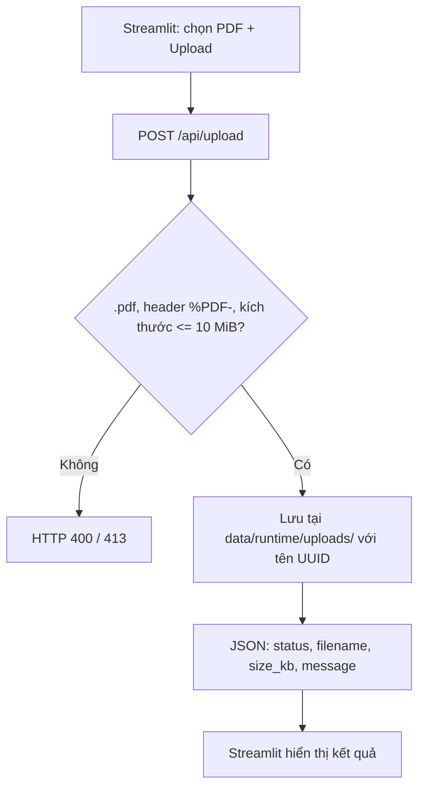
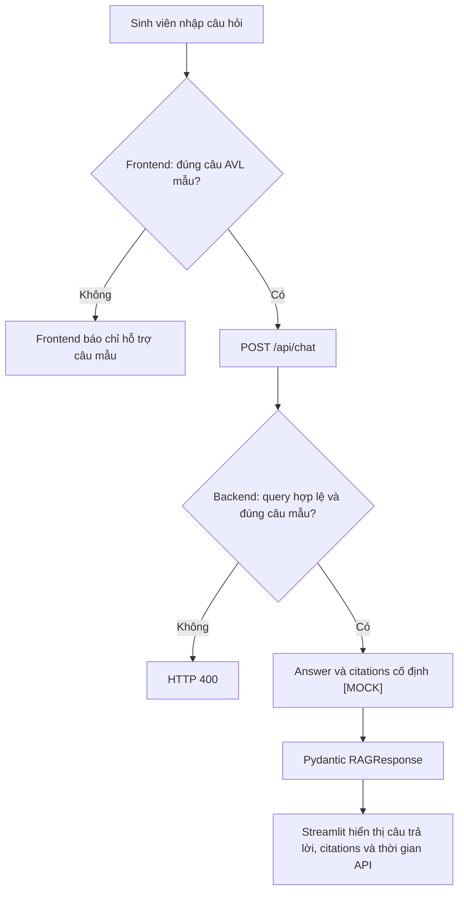

DSA Document Assistant Using Hybrid RAG
Track C — Intelligent Document Workspace
Lĩnh vực: Trợ lý học tập/ôn thi môn Cấu trúc dữ liệu và Giải thuật (DSA), dựa trên tài liệu PDF do người dùng cung cấp.
Trạng thái hiện tại: Proof of Concept (PoC) — Streamlit + FastAPI, PDF upload và một câu hỏi AVL giả lập.
Hệ thống chưa phải Hybrid RAG hoàn chỉnh: chưa trích xuất/chia chunk PDF, chưa lập chỉ mục BM25/Qdrant, chưa gọi FIT-AI LLM API và chưa xác minh trích dẫn thực. Nội dung trả lời AVL cùng các citation đều được viết sẵn để kiểm tra giao diện và API contract.

1. PoC hiện tại làm được gì?
Thành phần	Đã triển khai	Giới hạn
Frontend	Giao diện Streamlit có upload PDF, chat và kiểm tra health backend	Chưa có quiz/revision hoạt động
Backend	FastAPI: GET /, GET /health, POST /api/upload, POST /api/chat, /docs	Chưa kết nối Hybrid RAG
Upload PDF	Kiểm tra phần mở rộng .pdf, chữ ký %PDF-, dung lượng tối đa 10 MiB, lưu file với tên UUID	Không đọc nội dung, không chunk/index
Chat	Nhận đúng một câu hỏi AVL mẫu; trả answer và 2 citation theo schema	Trả lời, citation, confidence_score=0.95, is_safe=true là MOCK
Observability	Trả header X-Process-Time-MS cho các request /api/	Đo thời gian API, không phải thời gian Retrieval/LLM

Câu hỏi được hỗ trợ:
Cây AVL là gì và độ phức tạp tìm kiếm là bao nhiêu?

PDF được upload không ảnh hưởng đến câu trả lời mẫu; hai chức năng upload và chat chưa liên kết với nhau.
2. Cài đặt và chạy PoC hiện tại
2.1. Yêu cầu
- Git, Python 3.11.x, pip (khuyến nghị dùng Python 3.11 thống nhất nhóm).
- Laptop và Internet để tải dependencies lần đầu.
- Chạy hai terminal: một cho FastAPI, một cho Streamlit.
- Không cần Docker, Qdrant, PostgreSQL, GPU, FIT-AI API key hay Conda để chạy PoC này.
Các ví dụ bên dưới dành cho Windows PowerShell và giả định bạn bắt đầu tại thư mục gốc repository.
2.2. Clone và cài dependencies (làm một lần)
git clone https://github.com/quantapcot/DSA-Document-Assistant-Using-Hybrid-RAG.git
cd DSA-Document-Assistant-Using-Hybrid-RAG

# Tạo virtual environment Python 3.11 dùng chung cho frontend/backend
py -3.11 -m venv .venv

# Cài thư viện của hai ứng dụng
.\.venv\Scripts\python.exe -m pip install --upgrade pip
.\.venv\Scripts\python.exe -m pip install -r backend/requirements.txt -r frontend/requirements.txt

# Chỉ tạo .env khi chưa có (không ghi đè file cá nhân)
if (-not (Test-Path backend/.env)) {
    Copy-Item backend/.env.example backend/.env
}
Nếu py -3.11 không chạy, hãy kiểm tra phiên bản đã cài bằng py -0p. Lệnh dùng trực tiếp .venv\Scripts\python.exe nên không cần kích hoạt môi trường và không gặp lỗi PowerShell Execution Policy.
2.3. Terminal 1 — chạy FastAPI Backend
Mở terminal tại thư mục gốc repository rồi chạy:
cd backend
..\.venv\Scripts\python.exe -m uvicorn app.main:app --host 127.0.0.1 --port 8000 --reload
- Backend health: http://127.0.0.1:8000/health
- Swagger API docs: http://127.0.0.1:8000/docs
Lưu ý: Chạy app.main:app từ thư mục backend/ vì code import các module app.*. Giữ terminal này chạy.
2.4. Terminal 2 — chạy Streamlit Frontend
Mở terminal PowerShell thứ hai tại thư mục gốc repository:
cd frontend
..\.venv\Scripts\python.exe -m streamlit run app.py --server.address 127.0.0.1 --server.port 8501
Mở giao diện: http://127.0.0.1:8501.

Frontend mặc định kết nối backend tại http://127.0.0.1:8000. Khi cần đổi địa chỉ backend, đặt biến môi trường BACKEND_URL trước khi khởi chạy frontend. Để dừng, nhấn Ctrl+C tại mỗi terminal.
2.5. Kiểm thử PoC
1. Mở Streamlit, quan sát sidebar hiển thị trạng thái kết nối FastAPI (healthy).
2. Chọn file PDF thật tối đa 10 MiB, bấm Upload lên Backend. Backend chỉ lưu file tại data/runtime/uploads/ với tên ngẫu nhiên dạng UUID; không phân tích nội dung.
3. Nhập chính xác: Cây AVL là gì và độ phức tạp tìm kiếm là bao nhiêu? vào chat.
4. Xem câu trả lời cố định và mục Nguồn minh họa (MOCK). Tên file và trang trong citations là dữ liệu mẫu, không lấy từ PDF vừa upload.
5. Nhập câu hỏi khác: giao diện sẽ cho biết bản PoC chỉ hỗ trợ câu hỏi mẫu. Gọi API trực tiếp với câu khác trả HTTP 400.
6. Có thể kiểm tra API qua http://127.0.0.1:8000/docs.
2.6. Lỗi thường gặp
Triệu chứng	Cách xử lý
py -3.11 không tìm thấy	Cài Python 3.11, kiểm tra bằng py -0p
ModuleNotFoundError	Kiểm tra bước cài cả hai file requirements.txt bằng Python trong .venv
Streamlit không kết nối backend	Kiểm tra Terminal 1, URL /health và port 8000
Port 8000 hoặc 8501 đang sử dụng	Dừng tiến trình cũ hoặc đổi port và cập nhật BACKEND_URL
PDF bị từ chối	Kiểm tra đuôi .pdf, header %PDF-, dung lượng ≤10 MiB
Chat không hỗ trợ câu khác	Đây là giới hạn chủ ý của bản PoC

macOS/Linux: Tạo python3.11 -m venv .venv; cài bằng .venv/bin/python -m pip install -r backend/requirements.txt -r frontend/requirements.txt. Từ backend/ chạy ../.venv/bin/python -m uvicorn app.main:app --host 127.0.0.1 --port 8000; từ frontend/ chạy ../.venv/bin/python -m streamlit run app.py --server.port 8501. Có thể sao chép backend/.env.example thành backend/.env nếu cần.
3. Pipeline thực tế đang hoạt động
3.1. Upload PDF (chưa ingestion)

Chưa có: PyMuPDF extraction, làm sạch văn bản, chunking, BM25 index, embedding hay Qdrant.
3.2. Chat AVL MOCK

backend/app/api/routes/chat.py chuẩn hóa khoảng trắng và so khớp chính xác với câu mẫu; các giá trị confidence_score=0.95, is_safe=true được gán cứng. Middleware thêm X-Process-Time-MS cho các request /api/.
3.3. Pipeline Hybrid RAG dự kiến — chưa triển khai
Upload PDF → PDF extraction → cleaning / chunking → BM25 + Qdrant indexing

Question → Guardrails → BM25 + Dense Retrieval → RRF fusion
         → Cross-Encoder reranking → FIT-AI LLM → Citation verification
         → Answer / Abstain
Xem [architecture.md](docs/architecture.md) và Proposal để biết kiến trúc mục tiêu.
4. API và schemas
Method	Endpoint	Trạng thái hiện tại
GET	/	Thông tin ứng dụng
GET	/health	Trả healthy, tên app, môi trường, version; không kiểm tra LLM/DB
GET	/docs	Swagger UI
POST	/api/upload	Nhận và lưu PDF thật, chưa indexing
POST	/api/chat	Trả một câu hỏi AVL mock

Các schema trong [`backend/app/schemas/contracts.py`](backend/app/schemas/contracts.py):
- ChatRequest: câu hỏi query.
- RAGResponse: query, answer, citations, confidence_score, is_safe.
- Citation: filename, page, section, snippet.
- DocumentChunk, GuardrailResult: đã có hợp đồng dữ liệu nhưng chưa tích hợp xử lý.
quiz.py, revision.py là khung, chưa được đăng ký thành endpoints trong app/main.py.
5. Cây thư mục project hiện tại
Cây phản ánh repository hiện tại; lược bớt __init__.py, README phụ và một số file chi tiết để dễ đọc. [PoC] = đang dùng trong bản demo; [Khung] = vị trí cho tính năng chưa triển khai.
DSA-Document-Assistant-Using-Hybrid-RAG/
├── backend/
│   ├── app/
│   │   ├── main.py                         # [PoC] FastAPI app / routes
│   │   ├── api/
│   │   │   ├── routes/
│   │   │   │   ├── health.py               # [PoC] GET /health
│   │   │   │   ├── chat.py                 # [PoC] POST /api/chat (MOCK)
│   │   │   │   ├── upload.py               # [PoC] POST /api/upload (lưu PDF)
│   │   │   │   ├── quiz.py                 # [Khung]
│   │   │   │   └── revision.py             # [Khung]
│   │   │   └── middleware/
│   │   │       └── observability.py        # [PoC] X-Process-Time-MS
│   │   ├── core/config.py                 # [PoC] Pydantic Settings + .env
│   │   ├── schemas/contracts.py           # [PoC] Pydantic contracts
│   │   ├── orchestration/                 # [Khung] điều phối
│   │   ├── document_processing/           # [Khung] PDF parsing / chunks
│   │   ├── retrieval/                     # [Khung] BM25 / Dense / RRF
│   │   ├── generation/                    # [Khung] LLM / citations / quiz
│   │   │   └── prompts/                   # [Khung] prompts
│   │   └── safety/                        # [Khung] guardrails
│   ├── requirements.txt                   # [PoC] Python dependencies
│   ├── .env.example                       # Template biến môi trường
│   └── Dockerfile                         # [Khung] file rỗng
├── frontend/
│   ├── app.py                             # [PoC] Streamlit
│   ├── api_client.py                      # [PoC] requests → FastAPI
│   ├── screens/
│   │   ├── upload_ui.py                   # [PoC] upload UI
│   │   ├── chat_ui.py                     # [PoC] chat / citations MOCK
│   │   ├── quiz_ui.py                     # [Khung]
│   │   └── revision_ui.py                 # [Khung]
│   ├── components/                        # [Khung]
│   ├── .streamlit/config.toml
│   ├── requirements.txt                   # [PoC] Streamlit + requests
│   └── Dockerfile                         # [Khung] file rỗng
├── configs/                               # YAML ví dụ, chưa dùng
├── data/
│   ├── corpus/                            # Corpus DSA dự kiến
│   └── runtime/
│       ├── uploads/                       # [PoC] PDF được upload
│       ├── processed/                     # [Khung]
│       └── indexes/                       # [Khung]
├── evaluation/
│   ├── datasets/                          # [Khung] Ground Truth
│   ├── metrics/                           # [Khung] metrics
│   ├── scripts/                           # [Khung] benchmarks
│   ├── results/                           # [Khung]
│   └── reports/                           # [Khung]
├── tests/
│   ├── unit/                              # [Khung]
│   ├── integration/                       # [Khung]
│   └── fixtures/                          # [Khung]
├── docs/                                  # Kiến trúc, hợp đồng, hướng dẫn
│   ├── architecture.md
│   ├── setup.md
│   ├── data_contracts.md
│   └── ownership.md                        # Và các file docs khác
├── docker-compose.yml                     # [Khung] file rỗng
├── .gitignore
└── README.md
Lưu ý: data/runtime/ được .gitignore bỏ qua (trừ README hướng dẫn), cũng như file .env cá nhân. docker-compose.yml và hai Dockerfile còn rỗng; không dùng docker compose up để chạy PoC hiện tại.
6. Công nghệ PoC so với mục tiêu
Thành phần	PoC hiện tại	Mục tiêu
Frontend	Streamlit, requests	Quiz / Revision, citation thật
Backend	FastAPI, Uvicorn, Pydantic, Pydantic Settings, python-multipart	RAG, orchestration, guardrails
Document processing	Kiểm tra và lưu PDF	PyMuPDF, chunking, metadata
Retrieval	Chưa có	BM25, Sentence Transformers, Qdrant, RRF, Cross-Encoder
Generation	Mock AVL answer	FIT-AI LLM API
Deployment	Chạy local bằng hai terminal	Docker Compose: Streamlit, FastAPI, PostgreSQL, Qdrant
Evaluation	Chưa có benchmark	Baselines, Ground Truth, retrieval/answer metrics

7. Thành viên và phân công
Mã	Họ và tên	MSSV	Phân công
A1	Nguyễn Lê Phú Trọng	25127534	Backend và điều phối
A2	Nguyễn Văn An	25127010	Frontend và UI/UX
A3	Nguyễn Phú Nguyên Vũ	25127172	Tích hợp hệ thống và DevOps
B1	Nguyễn Thanh Danh	25127291	Xử lý tài liệu
C1	Trương Minh Quân	25127126	Tìm kiếm và truy xuất
C2	Hứa Kiến Quốc	25127130	RAG và sinh nội dung học tập
D1	Đặng Phan Gia Bảo	25127016	Benchmark và đánh giá chất lượng
D2	Nguyễn Minh Cường	25127286	An toàn và độ tin cậy

Tài liệu: [Setup backend](docs/setup.md) · [Kiến trúc mục tiêu](docs/architecture.md) · [Data contracts](docs/data_contracts.md) · [Phân công](docs/ownership.md)
