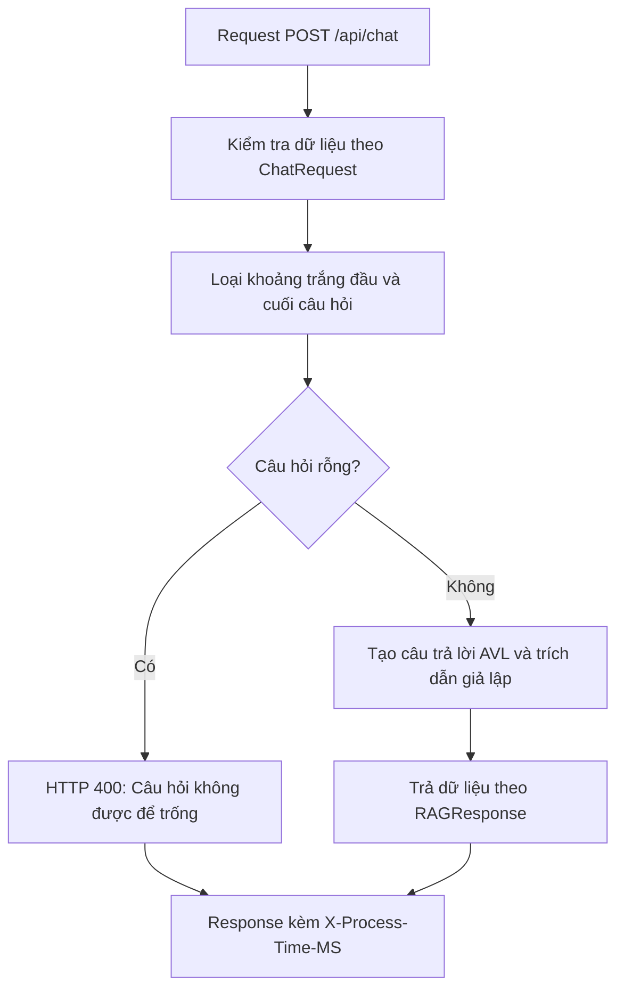

# DSA Document Assistant Using Hybrid RAG
### Khung backend cho trợ lý học tập môn Cấu trúc dữ liệu và Giải thuật

Dự án hiện ở giai đoạn xây dựng khung ban đầu. Phần đã có code là backend
**FastAPI**, các schema dữ liệu và API chat trả phản hồi **giả lập (mock)**.

> **Trạng thái hiện tại:** Backend scaffold / Mock API.
>
> Câu trả lời và trích dẫn trong chat được tạo từ dữ liệu mẫu cố định trong code.

---

## Cập nhật các phần đã có

- Khởi tạo ứng dụng FastAPI và đăng ký các route.
- Endpoint trả thông tin ứng dụng và endpoint health check.
- API chat nhận câu hỏi, loại khoảng trắng đầu/cuối và từ chối câu hỏi rỗng.
- Phản hồi chat mẫu về cây AVL, kèm trích dẫn giả lập theo tên file, trang và mục.
- Các schema Pydantic cho request, response, đoạn tài liệu và kết quả kiểm tra an toàn.
- Cấu hình ứng dụng qua biến môi trường và `.env`.
- Middleware đo thời gian xử lý request có đường dẫn bắt đầu bằng `/api/`,
  trả thời gian qua header `X-Process-Time-MS`.

---

## 1. Thành viên

Điền họ tên và MSSV vào bảng theo phân công của nhóm.

| Mã | Họ và tên | MSSV | Phân công |
| --- | --- | --- | --- |
| A1 | Nguyễn Phú Trọng | 25127534 | Backend và điều phối |
| A2 | Nguyễn Văn An | 25127010 | Frontend và UI/UX |
| A3 | Nguyễn Phú Nguyên Vũ | 25127172 | Tích hợp hệ thống và DevOps |
| B1 | Nguyễn Thanh Danh | 25127291 | Xử lý tài liệu |
| C1 | Trương Minh Quân | 25127126 | Tìm kiếm và truy xuất |
| C2 | Hứa Kiến Quốc | 25127130 | RAG và sinh nội dung học tập |
| D1 | Đặng Phan Gia Bảo | 25127016 | Benchmark và đánh giá chất lượng |
| D2 | Nguyễn Minh Cường | 25127286 | An toàn và độ tin cậy |

---

## 2. Tech Stack hiện tại

Các công nghệ dưới đây đã được sử dụng trong code backend. Mốc phiên bản là
yêu cầu tối thiểu khai báo trong [`backend/requirements.txt`](backend/requirements.txt),
không phải xác nhận phiên bản đã cài trên máy.

| Công nghệ | Phiên bản khai báo | Vai trò hiện tại |
| --- | --- | --- |
| Python | Chưa quy định phiên bản trong requirements | Ngôn ngữ backend |
| FastAPI | `>=0.110.0` | Khởi tạo API, khai báo endpoint và xử lý request/response |
| Uvicorn | `uvicorn[standard]>=0.28.0` | ASGI server được gọi trong entrypoint |
| Pydantic | `>=2.6.0` | Định nghĩa và kiểm tra cấu trúc dữ liệu |
| Pydantic Settings | `>=2.2.0` | Đọc cấu hình ứng dụng từ môi trường và `.env` |

---

## 3. Pipeline tạm thời

Luồng dưới đây phản ánh code hiện có của `POST /api/chat`.



`answer` nhắc lại câu hỏi của người dùng nhưng phần giải thích AVL và hai trích dẫn
được viết sẵn. `confidence_score = 0.95` và `is_safe = true` cũng là giá trị gán
sẵn, không phải kết quả đo độ tin cậy hoặc kiểm tra an toàn.

---

## 4. API và schema hiện có

### Endpoint

| Method | Đường dẫn | Xử lý hiện tại |
| --- | --- | --- |
| GET | `/` | Trả lời chào và đường dẫn API docs |
| GET | `/health` | Trả trạng thái, tên ứng dụng, môi trường và phiên bản khai báo |
| POST | `/api/chat` | Nhận câu hỏi và trả phản hồi chat giả lập |
| GET | `/docs` | Tài liệu Swagger UI do FastAPI cung cấp |

`/health` hiện trả thông tin từ cấu hình; không kiểm tra kết nối dịch vụ bên ngoài.

### Schema

Các class đã được định nghĩa trong
[`backend/app/schemas/contracts.py`](backend/app/schemas/contracts.py):

| Schema | Dữ liệu được mô tả |
| --- | --- |
| `ChatRequest` | Câu hỏi `query` |
| `RAGResponse` | Câu hỏi, câu trả lời, trích dẫn, điểm tin cậy và cờ an toàn |
| `Citation` | Tên file, số trang, mục và đoạn trích |
| `DocumentChunk` | Định danh đoạn/tài liệu, nội dung và metadata nguồn |
| `GuardrailResult` | Cờ an toàn, nhóm rủi ro và thông điệp từ chối |

API chat hiện sử dụng `ChatRequest`, `RAGResponse` và `Citation`.
`DocumentChunk` và `GuardrailResult` mới có định nghĩa dữ liệu.

---

## 5. Cây thư mục project

Cây dưới đây thể hiện các thư mục chính và một số file tiêu biểu đang có trong repo.
`[Khung]` là phần đã có thư mục/file nhưng chưa triển khai chức năng.
Lược bỏ `.git/`, cache Python, `__init__.py` và các README con để dễ đọc.

```text
DSA-Document-Assistant-Using-Hybrid-RAG/
├── backend/
│   ├── app/
│   │   ├── main.py                    # Khởi tạo FastAPI và đăng ký router
│   │   ├── api/
│   │   │   ├── routes/                # Health, chat mock; các route khác còn rỗng
│   │   │   └── middleware/            # Đo thời gian request /api/
│   │   ├── core/
│   │   │   └── config.py              # Cấu hình ứng dụng
│   │   ├── schemas/
│   │   │   └── contracts.py           # Schema Pydantic hiện có
│   │   ├── orchestration/            # [Khung] Điều phối
│   │   ├── document_processing/      # [Khung] Xử lý tài liệu
│   │   ├── retrieval/                # [Khung] Truy xuất
│   │   ├── generation/               # [Khung] Sinh nội dung
│   │   │   └── prompts/              # Mới có README hướng dẫn
│   │   └── safety/                   # [Khung] Kiểm tra an toàn
│   ├── .env.example                  # Mẫu biến môi trường
│   ├── requirements.txt              # Dependencies backend
│   └── Dockerfile                    # File rỗng
├── frontend/                         # [Khung] Giao diện
│   ├── app.py                        # File rỗng
│   ├── api_client.py                 # Mới có mô tả nhiệm vụ
│   ├── screens/                      # Bốn file màn hình còn rỗng
│   ├── components/                   # Mới có README hướng dẫn
│   ├── requirements.txt              # File rỗng
│   └── Dockerfile                    # File rỗng
├── configs/
│   ├── retrieval.example.yaml        # Cấu hình mẫu, chưa được ứng dụng đọc
│   └── generation.example.yaml       # Cấu hình mẫu, chưa được ứng dụng đọc
├── data/                             # Mới có README hướng dẫn, chưa có dữ liệu
│   ├── corpus/
│   └── runtime/
│       ├── uploads/
│       ├── processed/
│       └── indexes/
├── evaluation/                       # [Khung] Đánh giá
│   ├── datasets/                     # Chưa có bộ dữ liệu đánh giá
│   ├── metrics/                      # File chỉ có mô tả nhiệm vụ
│   ├── scripts/                      # Script còn rỗng
│   ├── results/                      # Chưa có kết quả
│   └── reports/                      # Chưa có báo cáo
├── tests/                            # Mới có README hướng dẫn, chưa có test
│   ├── unit/
│   ├── integration/
│   └── fixtures/
├── docs/                             # Tài liệu cấu trúc, phân công và thiết kế
├── .gitignore
├── docker-compose.yml                # File rỗng
└── README.md
```

---


