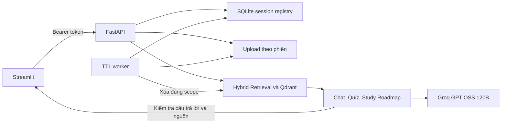

# Kế hoạch triển khai Intelligent Document Workspace MVP V2

## Kiến trúc

Hiện tại, Streamlit gửi workspace/corpus do người dùng nhập tới FastAPI. Retrieval trả bằng chứng theo scope. Chat và các tính năng học có cấu hình LLM riêng. Revision lập lịch theo ngày và xác minh nội dung theo batch.

MVP V2 dùng một phiên tạm của Streamlit và token ngẫu nhiên do FastAPI cấp. FastAPI ánh xạ token tới scope riêng, dùng SQLite trong thư mục runtime để lưu hash token và hạn dùng. Thư mục upload theo phiên tách biệt. TTL được dọn định kỳ sau khi backend khởi động, kể cả dữ liệu của tiến trình cũ.

## Thứ tự triển khai

| Giai đoạn | Module chính | Phụ thuộc và tiêu chí |
| --- | --- | --- |
| 1. Groq | `llm_client.py`, `rag_engine.py`, settings, requirements | Một client, structured JSON khi có schema, Pydantic, timeout và retry có giới hạn. Test lỗi 429, quota, timeout, JSON lỗi và không lộ key. |
| 2. Phiên | session registry, session API, scope resolver, Upload/Document API và Streamlit | Token bắt buộc cho scope phiên. Test A/B, hết hạn, restart, xóa đúng scope và giữ corpus Evaluation. |
| 3. Roadmap | `revision_generator.py`, `study_planner.py`, contracts, route, UI | Dùng inventory phiên từ phase 2, tái sử dụng dependency graph. Một lần sinh chính nếu vừa ngân sách. Test nguồn, thứ tự, mục trùng, phiên rỗng và checklist. |
| 4. Quiz | orchestration, generator, quiz UI | Đo baseline số lượt trước khi đơn giản hóa. Kiểm tra 1/3/5 câu, tiếng Việt, ngữ cảnh tự đầy đủ, giải độc lập, giải thích và trích đoạn. |
| 5. Đo lường | middleware và telemetry của LLM, Quiz, Roadmap | Đo latency end-to-end, retrieval, provider, số retry và số lượt. So sánh số lượt từ fixture, chỉ báo latency thực khi cùng điều kiện đo. |
| 6. Kiểm thử | unit và integration | Kiểm thử workflow Streamlit/API, cách ly phiên, restart, lỗi provider và regression. Smoke Groq nếu có key. |
| 7. Bàn giao | README, tài liệu API và env, Git | Kiểm tra diff, commit và xác minh branch feature trên origin. |

## Rủi ro và giới hạn

- Lỗi giữa xóa Qdrant và file được xử lý bằng trạng thái chờ dọn, cho phép retry. Cần volume bền vững cho dữ liệu tạm khi chạy Docker.
- Một token thất lạc cấp quyền trong phiên đó đến khi hết hạn. Token không xuất hiện trong URL, log hoặc dữ liệu lưu trữ dạng rõ.
- MVP chạy với một backend worker để khóa thao tác Upload/xóa scope cùng tiến trình. Khởi động lại frontend tạo phiên mới. Phiên cũ còn hiệu lực đến thời hạn đã cấp nếu token vẫn được giữ.
- Nguồn tài liệu có thể chứa chỉ dẫn gây sai lệch. Prompt coi tài liệu là dữ liệu, Python xác minh nhãn nguồn và trích đoạn, Quiz vẫn giải độc lập.
- Giữ nguyên Retrieval core, candidate pool, corpus, dataset và Evaluation. Scope legacy được giữ tách biệt. Các thay đổi Pooled Evaluation đã lưu trong stash được giữ nguyên.
- Phát triển trực tiếp ở repository chính trên branch feature đã có cùng điểm xuất phát với `origin/main`.

## Trạng thái

Audit xác nhận `deaecbb` chứa Quiz MVP và Retrieval Evaluation. Các phase 1–7 đã được triển khai trên `feat/mvp-v2-study-workspace`.

- Groq dùng chung cho cả ba luồng. Đã xác minh JSON Schema strict và payload qua SDK thực với transport giả lập. Smoke Groq thật trả mã 77 vì môi trường chưa có `GROQ_API_KEY`.
- Đã kiểm thử Upload PDF/DOCX, Chat, Quiz, Roadmap, checklist và luồng Roadmap → Quiz. Hai phiên tách biệt cả lúc mở phiên mới, xóa phiên và khởi động lại. Test khởi động lại xác minh worker dọn scope hết hạn trên Qdrant local và giữ dữ liệu phiên còn hiệu lực cùng scope Evaluation.
- Baseline có 24 test đạt. Fixture Quiz với bằng chứng mỏng và một lần fallback reranker ghi nhận số lượt gọi Retrieval giảm từ 5 xuống 3, tương ứng 4 xuống 2 nếu bỏ lượt fallback. Fixture Roadmap cho 2 hoặc 12 tài liệu dùng một lần gọi Groq giả lập. Chưa đo latency trên Groq thật.
- Regression sau triển khai có 216 test đạt, 0 lỗi, 0 bỏ qua. Retrieval core, cấu hình candidate pool, corpus và dataset Evaluation giữ nguyên. Pooled Evaluation vẫn nằm trong stash ban đầu.
